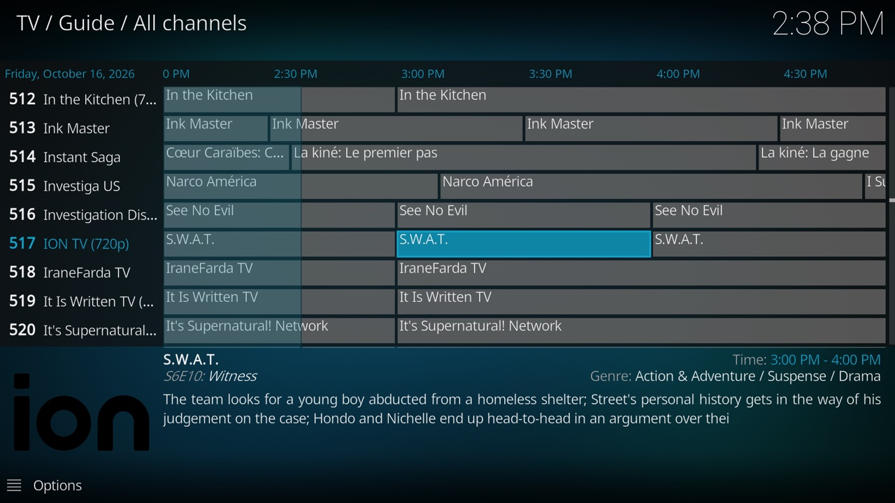

# kodi-iptv-assistant

Turn free internet TV into a tidy channel list with a working program guide in Kodi.



## Why this exists

Kodi and free IPTV make a great pair, but turning a raw playlist into something you'd want to watch is a mess. Public playlists list thousands of streams, and on any given day a good share of them are offline, moved, or blocked where you live. Guide data exists for many of those channels, but it's spread across dozens of sites whose channel IDs rarely match your playlist's, so Kodi can't connect them and the guide stays mostly empty. And streams change daily, so a list that works this week is half broken next month.

kia (kodi-iptv-assistant) does the cleanup every night. It tests every stream in the playlists you pick and keeps one working stream per channel. It finds guide data for those channels and builds a single guide file that lines up with the list. Then it serves both on your network, so you set up each Kodi device once and it stays current.

Channels with no guide data anywhere (small local stations, for example) show their name in the guide instead of a blank row. kia can also add internet radio stations, which appear under Radio in Kodi.

## What you need

- A computer to run kia: macOS, Linux, or a Raspberry Pi 4/5. It can be the one you watch on or one that stays on for the house.
- [Docker](https://docs.docker.com/get-docker/) (Docker Desktop on macOS) and Git.
- [Kodi](https://kodi.tv/download/) on the devices you watch on: Windows, macOS, Linux, Android TV, Fire TV, and others all work (setup below).

## Quick start

New to Docker or Git? [docs/install.md](docs/install.md) walks through installing everything, step by step. If you already have Docker and Git:

1. Download and configure:

   ```sh
   git clone https://github.com/southsidedean/kodi-iptv-assistant.git
   cd kodi-iptv-assistant
   cp .env.example .env
   ```

   Open `.env` and set `KIA_PUBLIC_URL` to this computer's address (e.g. `http://192.168.1.20:8780`) and `TZ` to your time zone.

2. Pick your playlists. Copy the list with `cp sources.txt sources.local.txt`, set `KIA_SOURCES_FILE=sources.local.txt` in `.env`, then remove the `#` in front of the playlists you want in `sources.local.txt`. The USA list is on by default. Updating kia never touches your copy.

3. Start it:

   ```sh
   docker compose up -d --build
   ```

   The first run takes up to an hour. Watch it with `docker compose logs -f kia`.

4. Set up Kodi on each device you watch on:
   - Install Kodi from [kodi.tv/download](https://kodi.tv/download/) (Windows, macOS, Linux, Android; app stores on some devices).
   - Add IPTV Simple Client: *Settings → Add-ons → Install from repository → PVR clients → IPTV Simple Client*.
   - In the add-on's settings, set **Location** to *Remote path (Internet address)* and **M3U playlist URL** to `http://<your address>:8780/curated.m3u`. Set **Auto refresh mode** to *Once per day* and **Refresh hour (24h)** to 6, so Kodi picks up kia's 4:00 refresh. Then restart Kodi.

   Channels appear under TV, and the guide fills in by itself. Step by step, with tips for Fire TV and Raspberry Pi: [docs/kodi.md](docs/kodi.md).

To check on kia, open `http://<your address>:8780/` in a browser. The status page there shows when it last refreshed, whether that worked, how many channels it found, and any alerts, with links to the detailed reports. If something isn't working, [docs/troubleshooting.md](docs/troubleshooting.md) goes through the usual problems.

## Setups

By default, one machine serves every Kodi device in the house. kia can also run on the same computer you watch on, on a Raspberry Pi with lower settings, or on a laptop that travels: the laptop tests streams wherever you are, copies the guide from your home server when it can reach it, and builds its own when it can't. Recipes for each are in [docs/setups.md](docs/setups.md).

## Configuration

| File | For |
|---|---|
| `sources.txt` | Which playlists and radio stations to use |
| `.env` | How it runs on this machine: address, schedule, time zone, memory |
| `kia.toml` | Fine-tuning: timeouts, filters, guide sources, alerts |

All the settings are listed in [docs/configuration.md](docs/configuration.md).

## How it works

Each night kia tests every stream with `ffprobe`, matches the working channels to guide sources from [iptv-org/epg](https://github.com/iptv-org/epg), downloads the guide data, and keeps the best source for each channel. When a name lookup fails, it checks public DNS to tell a dead stream from a problem on your network. The details are in [docs/how-it-works.md](docs/how-it-works.md).

If something breaks that needs you, such as your network's DNS failing or the nightly refresh crashing, kia can send a notification to your phone. Setup takes about five minutes: [docs/alerts.md](docs/alerts.md).

## Updating and stopping

kia refreshes every night at 4:00. To change the time, set `KIA_RUN_AT` in `.env`. Changes to your playlists or settings show up after the next run; to refresh right away, see [when changes take effect](docs/configuration.md#when-changes-take-effect).

To update kia, run these in the kia folder:

```sh
git pull
docker compose build --pull
docker compose pull --ignore-buildable
docker compose up -d
```

This also brings the latest Node.js and nginx images; to stay on fixed versions, see [versions](docs/configuration.md#versions). Your `.env`, your own playlist list, and the stream history are kept. If you edited `sources.txt` or `kia.toml` directly, git may ask you to commit or stash those changes first.

To stop kia, run `docker compose down`. While it's stopped, Kodi can't refresh the channel list or guide.

## Credits

Playlists come from [iptv-org/iptv](https://github.com/iptv-org/iptv) and others; guide sources from [iptv-org/epg](https://github.com/iptv-org/epg) and [i.mjh.nz](https://github.com/matthuisman/i.mjh.nz). This project only tests and organizes publicly listed streams; it doesn't host any.

## License

kia is free software under the [GNU Affero General Public License v3.0](LICENSE). You can use, change, and share it. If you share a modified version, or run one as a service for other people, you must make your source code available under the same license.

If you publish a fork, please give it a different name so people don't confuse it with this project.
