# A TV in every room

One computer that stays on runs kia for the whole house. Every TV, tablet, and phone gets the same channels and guide, a channel has the same number everywhere, and each room or person can have a shorter playlist of their own, such as one just for the kids.

<picture>
  <source media="(prefers-color-scheme: dark)" srcset="../../images/diagrams/every-room-dark.svg">
  
</picture>

## What you need

- A computer that stays on: a Linux box, a mini PC, a NAS that runs Docker, or a Raspberry Pi 4 or 5 with 4 GB of memory. See [setups](../setups.md) for each.
- A player app on each device. [Choosing a player](../players.md) lists them: Kodi or TiviMate on TVs and TV boxes, UHF or Televizo on phones and tablets, and Plex or Jellyfin if you already use them.

## 1. Set up the server

Follow [installing kia](../install.md) on the computer that stays on. With the one-line installer, accept the address it suggests: that's the address the other devices use, and this guide calls it `192.168.1.20`.

Give the server an address that doesn't change: in your router's settings, reserve its current address for it (often called a *DHCP reservation*). Otherwise, after a router restart, the server can get a new address and every device loses its channels.

Wait for the first refresh to finish; the Dashboard at `http://192.168.1.20:8780/` says when.

## 2. Make a playlist for each room or person

The full playlist has every channel that works, often over a thousand. A shorter one is quicker to load and easier to browse, especially on a phone or a slow TV stick. On the secure Dashboard, `https://192.168.1.20:8743/`, go to **Playlists** and choose **Make a playlist**. Some ideas:

| Playlist | Settings |
|---|---|
| `kids` | Only the categories Kids, Animation, and Family; no radio; numbered from 1 |
| `living-room` | Every channel, leaving out the categories Shop and Religious |
| `kitchen` | Only channel names with "news" or "weather"; no radio |

Each playlist gets its own address, such as `http://192.168.1.20:8780/kids.m3u`, and its own guide with only its channels. On our test install, the kids' playlist above had 72 channels, and its guide was an eighth of the full one's size.

Some channels are in more than one category: a few kids' channels are also marked Religious, for example. Each playlist's page shows every channel's categories, and **Leave out** removes any you don't want. [Playlists for people and devices](../profiles.md) explains every setting.

## 3. Set up each device

In each device's player, use the playlist for that room or person:

| Device | App | Guide |
|---|---|---|
| Fire TV, Android TV, a Raspberry Pi with LibreELEC, a computer | Kodi | [Setting up Kodi](../kodi.md) |
| Android TV, Google TV, Nvidia Shield | TiviMate | [TiviMate](../tivimate.md) |
| iPhone, iPad, Apple TV, Android phones and tablets | UHF or Televizo | [Phones and tablets](../phones.md) |
| Any TV or phone with Plex | Plex, through Threadfin | [Plex](../plex.md), or [a home TV box](plex-box.md) to run Plex on the same server |
| Any TV or phone with Jellyfin | Jellyfin | [Jellyfin](../jellyfin.md), or [a Jellyfin TV box](jellyfin-box.md) to run Jellyfin on the same server |

kia tells Kodi where each playlist's guide is. Other apps ask for it: use the guide address on the playlist's page, such as `http://192.168.1.20:8780/kids.guide.xml.gz`.

## 4. The same numbers everywhere

A channel has the same number in every playlist, so 45 in the living room is 45 in the kitchen. The exception is a playlist numbered from 1, like the kids' one above, which is easier for small hands on a remote. In Kodi, turn on **Use channel numbers from backend** ([Setting up Kodi](../kodi.md#5-keep-channel-numbers-steady-optional), step 5) so Kodi uses kia's numbers.

To choose numbers yourself, or star favorites that show up as a Favorites group, use the **Everything** playlist's page on the secure Dashboard ([favorites and your own channel numbers](../configuration.md#favorites-and-your-own-channel-numbers)).

## How much the server does

Each device fetches its streams straight from the internet, so adding a TV adds almost nothing for the server: it hands out playlist and guide files. The exception is Pluto TV channels, which kia passes on itself ([why](../how-it-works.md#pluto-tv)). Each one being watched takes about 2 to 3% of one processor core on the PCs we measured, and 22% on a Raspberry Pi 3B, an older and slower board than the Pi 4 or 5 kia needs.

The nightly refresh is the busy part: up to an hour of checking streams and downloading the guide, at 4:00 unless you change `KIA_RUN_AT`.

## Keeping it running

Have kia send a message to your phone when the nightly refresh fails, so you hear about it before anyone else in the house ([alerts](../alerts.md)). Back up kia's settings, playlists, and favorites now and then ([backing up](../configuration.md#backing-up-and-moving-to-another-computer)). To update kia, follow the steps in the [README](../../README.md#updating-and-stopping), which also update the images.

## If something's wrong

**One device has no channels.** Open the playlist's address in a browser on a device on the same network. If it doesn't load, the device can't reach the server: check the address, and that a firewall on the router or the device isn't blocking it ([troubleshooting](../troubleshooting.md#other-devices-cant-connect)).

**Every device lost its channels at once.** The server is off, or its address changed. See step 1 about a fixed address.

**A channel has different numbers on two devices.** One of the playlists is numbered from 1, or one of the Kodis isn't using kia's numbers (step 4).

**The kids' playlist has a channel it shouldn't.** Find its categories on the playlist's page and add one to **Leave out**, or leave out that channel by name.

For the rest, see [troubleshooting](../troubleshooting.md).
