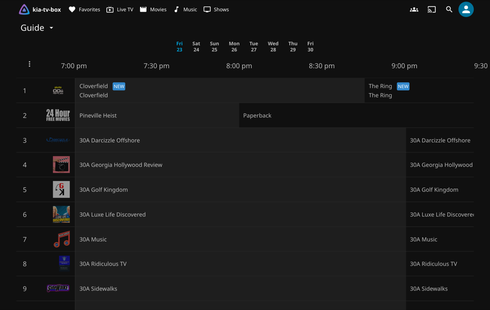

# A home TV box with Jellyfin: kia and Jellyfin in containers

[Jellyfin](https://jellyfin.org) is free software for your movies, shows, and music, with live TV built in. This guide runs it next to kia on one computer, so every Jellyfin app in the house gets kia's channels and guide, plus your own media. Jellyfin reads kia's playlist and guide directly, so there's no Threadfin and no channel limit.

> **Beta.** This guide was tested from start to finish on Linux and on a Mac, with Jellyfin 12.3 in a web browser. It hasn't been tried with Jellyfin's TV and phone apps yet. If something doesn't work, please [open an issue](https://github.com/southsidedean/kodi-iptv-assistant/issues).

What stays on disk, so nothing is lost when the containers restart or update:

| Folder (in the kia folder) | What's in it | Set in `.env` |
|---|---|---|
| `jellyfin/config` | Jellyfin's settings, users, and database (on a Mac, the Docker volume `jellyfin-config`: [why](../configuration.md#on-a-mac)) | `KIA_JELLYFIN_CONFIG` |
| `jellyfin/cache` | Pictures and video Jellyfin converts while it plays | `KIA_JELLYFIN_CACHE` |
| `media` | Your movies, shows, and music; Jellyfin can read them but not change them | `KIA_MEDIA_DIR` |

If Jellyfin already runs on another computer, or outside Docker, use the [Jellyfin guide](../jellyfin.md) instead: it adds kia to the Jellyfin you have.

## What you need

- A computer that stays on, running Linux or macOS with Docker. A small PC or an old laptop is enough for live TV; converting video for your own media takes more.
- About 3 GB of disk for kia and Jellyfin, plus room for your media.

## 1. Install kia

Follow [installing kia](../install.md), steps 1 to 6. The quick way is one command, which also asks for this computer's address; this guide uses `192.168.1.20` as the example. Wait for the first refresh to finish: the Dashboard at `http://192.168.1.20:8780/` says when it's done.

## 2. Turn on Jellyfin

In the kia folder, set these lines in `.env` (they're already in the file, empty; fill those in, because Docker Compose uses the last copy of a line):

```sh
KIA_STACK=jellyfin
KIA_JELLYFIN_ADVERTISE=http://192.168.1.20:8096
```

`KIA_STACK` can name more than one part, such as `jellyfin,plex` for both ([the parts you can choose](../stack.md)).

To use your own media folder (a second disk, or [shares on a NAS](plex-box.md#media-on-a-nas-or-another-server)), set `KIA_MEDIA_DIR=/path/to/your/media`. Then start it:

```sh
scripts/stack.sh apply
docker compose ps
```

After a minute, `docker compose ps` shows `jellyfin` as `healthy`.

## 3. Set up Jellyfin

Open `http://192.168.1.20:8096` in a browser. Jellyfin's setup takes a few screens:

1. **Server name** and **Preferred display language**. The name is already `kia-tv-box` (`KIA_JELLYFIN_NAME` in `.env` changes it); it shows in every Jellyfin app.
2. **Tell us about yourself:** a username and password for Jellyfin's administrator. This is Jellyfin's own account; it has nothing to do with kia's password.
3. **Set up your media libraries:** choose **Add Media Library**, pick the **Content type** (Movies, Shows, Music, and so on), and under **Folders** choose **+** and the folder under `/data`, your media folder: `/data/movies` for movies, for example. You can also skip this and add libraries later, under **Dashboard → Libraries**.
4. **Preferred Metadata Language** and **Set up Remote Access**: the defaults are fine.
5. **You're Done!** Choose **Finish**, then sign in with the user you made.

## 4. Add kia's channels

1. Open the user menu (the round button at the top right), choose **Dashboard**, then **Live TV** in the Dashboard's menu.
2. Choose **Add Tuner Device**. Set **Tuner type** to **M3U Tuner**, enter `http://web/tv.m3u` in **File or URL**, and choose **Save**. Leave the other settings as they are.
3. Choose **Add Provider**, then **XMLTV**. Enter `http://web/tv.guide.xml.gz` in **File or URL**, and choose **Save**.

`web` is kia's web server, as Jellyfin reaches it inside Docker. `tv.m3u` is kia's playlist without radio stations, which Jellyfin would show as TV channels numbered separately from TV ([why](../jellyfin.md#before-you-start-the-tv-only-playlist)). For fewer channels, use a [playlist you made](../profiles.md) instead, such as `http://web/kids.m3u` with `http://web/kids.guide.xml.gz`.

Jellyfin starts loading the guide straight away; with all of kia's channels it takes a few minutes the first time. It reads the guide again by itself every day, and kia keeps it current.

## 5. Watch

Open **Live TV** in any Jellyfin app: the web page, or Jellyfin for Android, iPhone, Android TV, Fire TV, Roku, and others. Channels show with kia's numbers and guide.



## 6. See what's playing (optional)

With the [observability cookbook](observability.md), kia can also count what Jellyfin plays, like it does for Plex. In Jellyfin, go to **Dashboard → API Keys**, choose **New API Key**, and name it `kia`. Copy the key into `.env`, then run `docker compose up -d`:

```sh
KIA_JELLYFIN_URL=http://jellyfin:8096
KIA_JELLYFIN_TOKEN=the-key-you-copied
```

kia's [metrics](../metrics.md) then include `kia_jellyfin_sessions`: live TV and your own media, and whether Jellyfin converts the video.

## Keeping it running

- Everything starts again when the computer restarts.
- **Updating kia:** follow the steps in the [README](../../README.md#updating-and-stopping), which also update Jellyfin's image. Do it when nobody's watching, because Jellyfin restarts.
- **Backups:** `docker compose exec kia python3 -m kia backup` saves kia's settings ([backups](../configuration.md#backing-up-and-moving-to-another-computer)). Jellyfin's own settings are in `jellyfin/config`; Jellyfin explains [what to back up](https://jellyfin.org/docs/general/administration/backup-and-restore/).

## If something's wrong

**Jellyfin has no channels, or no guide.** Check the addresses in step 4, then choose **Refresh Guide Data** on the Live TV page. `docker compose exec jellyfin curl -sI http://web/tv.m3u` should answer `200 OK`.

**A channel's name is missing its first word, a number** ("Hour Free Movies" for *24 Hour Free Movies*). Jellyfin takes a number at the start of a channel name as its channel number. The channel, its number, and its guide are right; only the name is shorter.
