# Kodi and kia on one computer

One laptop or desktop finds free TV channels, checks which ones play, builds their program guide, and plays them in Kodi. You don't need a server or a TV box, and nothing is open to the rest of your network.

<picture>
  <source media="(prefers-color-scheme: dark)" srcset="../../images/diagrams/kodi-computer-dark.svg">
  
</picture>

kia keeps everything up to date on its own: it checks every stream each night, refreshes the guide every few hours, and catches up after the computer has been asleep or off.

## What you need

- A Mac, or a computer running Linux. kia doesn't run on Windows yet.
- About 2 GB of disk space.
- Docker (Docker Desktop on a Mac). Or, to run kia without Docker: Python 3.11 or newer, ffmpeg, git, and Node.js. Step 1 explains the choice.

## 1. Install kia

There are two ways. Both end with kia running in the background and starting again when you log in.

**With Docker (the easy way).** Install Docker and Git as in [installing kia](../install.md), steps 1 and 2, then run the one-line installer from [the quick way](../install.md#the-quick-way). When it asks for this computer's address, type `localhost`:

```text
This computer's address on your network (for other devices) [192.168.1.20]: localhost
```

With `localhost`, kia is reachable only from this computer. On a Mac, also open Docker Desktop's settings and turn on **Start Docker Desktop when you sign in to your computer**, or kia won't be running after a restart.

**Without Docker (lighter).** Docker Desktop keeps a virtual machine running, with its own share of memory. Without Docker, kia runs as an ordinary program instead. Install what it needs (on a Mac with [Homebrew](https://brew.sh/): `brew install python ffmpeg git openssl node`; on Ubuntu or Debian, see [setups](../setups.md#without-docker)), then:

```sh
git clone https://github.com/southsidedean/kodi-iptv-assistant.git
cd kodi-iptv-assistant
scripts/update.sh --no-restart  # the newest release
cp .env.example .env
chmod 600 .env
```

Open `.env` in a text editor and set these lines, with your own time zone:

```ini
KIA_PUBLIC_URL=http://localhost:8780
KIA_BIND=127.0.0.1
TZ=America/New_York
```

Then start kia:

```sh
scripts/install-service.sh
```

Either way, kia prints the Dashboard's address and a password for making changes. Keep the password somewhere safe.

## 2. Wait for the first refresh

kia's first refresh checks every stream and downloads the guide. It takes up to an hour; you don't need to watch it. Open the Dashboard at `http://localhost:8780/`: when **Getting started** ticks "kia finishes its first refresh", it's done.

## 3. Set up Kodi

Install Kodi from [kodi.tv/download](https://kodi.tv/download/), then follow [setting up Kodi](../kodi.md), steps 2 to 5, with this playlist address:

```text
http://localhost:8780/curated.m3u
```

Leave the guide address (**XMLTV URL**) empty; the playlist tells Kodi where the guide is. Do set the **Repeated refresh** every 120 minutes, as the Kodi guide says: kia updates the guide every few hours, and Kodi then picks the changes up without a restart. Restart Kodi, and your channels are under **TV**, with their guide.


## 4. Make it yours (optional)

On the secure Dashboard, `https://localhost:8743/` (your browser warns about kia's own certificate the first time; it's safe to continue):

- On a playlist's page, the star puts a channel in Kodi's Favorites group.
- To choose channel numbers, turn on **Use channel numbers from backend** in Kodi (step 5 of the Kodi guide), then change numbers on the **Everything** playlist's page.
- The **Sources** page adds other countries or streaming services.
- The **Playlists** page makes a smaller playlist, such as news and sports only. Use its address in Kodi instead of `curated.m3u`.

## Living with it

**When kia refreshes.** The nightly run starts at 4:00 and uses a fair amount of processor and network for up to an hour. To move it, set `KIA_RUN_AT` in `.env` (for example `KIA_RUN_AT=13:00`), then apply the change (below). You can keep watching during a run.

**Asleep or off at that time.** If the computer is asleep, the run starts within a minute of waking. If it was off, the run starts when kia does, after you log in. Either way, the morning after can be busy for a while, so pick a time when the computer is usually on and you're not using it much.

**After changing `.env`.** In the kia folder, with Docker: `docker compose up -d`. Without Docker: `scripts/install-service.sh` again.

**Updating kia.** In the kia folder, `scripts/update.sh` with Docker, or `scripts/update.sh --no-docker` without ([updating](../../README.md#updating-and-stopping)).

**Watching on other devices later.** To let a TV, phone, or another computer in the house use this kia, change the two lines in `.env` to this computer's network address and `KIA_BIND=0.0.0.0`, as in [setups → home server](../setups.md#home-server), and apply the change. A computer that sleeps makes a poor server, though: the other devices lose their channels while it's asleep.

**Removing kia.** With Docker, in the kia folder: `scripts/install-service.sh --stack --uninstall` (if you installed the kia-stack service), then `docker compose down`, then delete the folder. Without Docker: `scripts/install-service.sh --uninstall`, then delete the folder.

## If something's wrong

**Kodi says it can't load the playlist.** kia isn't running, or hasn't finished its first refresh. Open `http://localhost:8780/`: if it doesn't load, start kia (on a Mac with Docker, start Docker Desktop). If it loads, wait for the first refresh.

**No channels after restarting the computer.** Kodi may have started before kia. Restart Kodi, or wait: with Repeated refresh on, Kodi tries again within two hours.

**The computer is slow every morning.** That's the nightly run catching up after the computer was asleep or off. Move it to a better time with `KIA_RUN_AT`.

For the rest, see [troubleshooting](../troubleshooting.md), which starts with the problems you see in Kodi.
