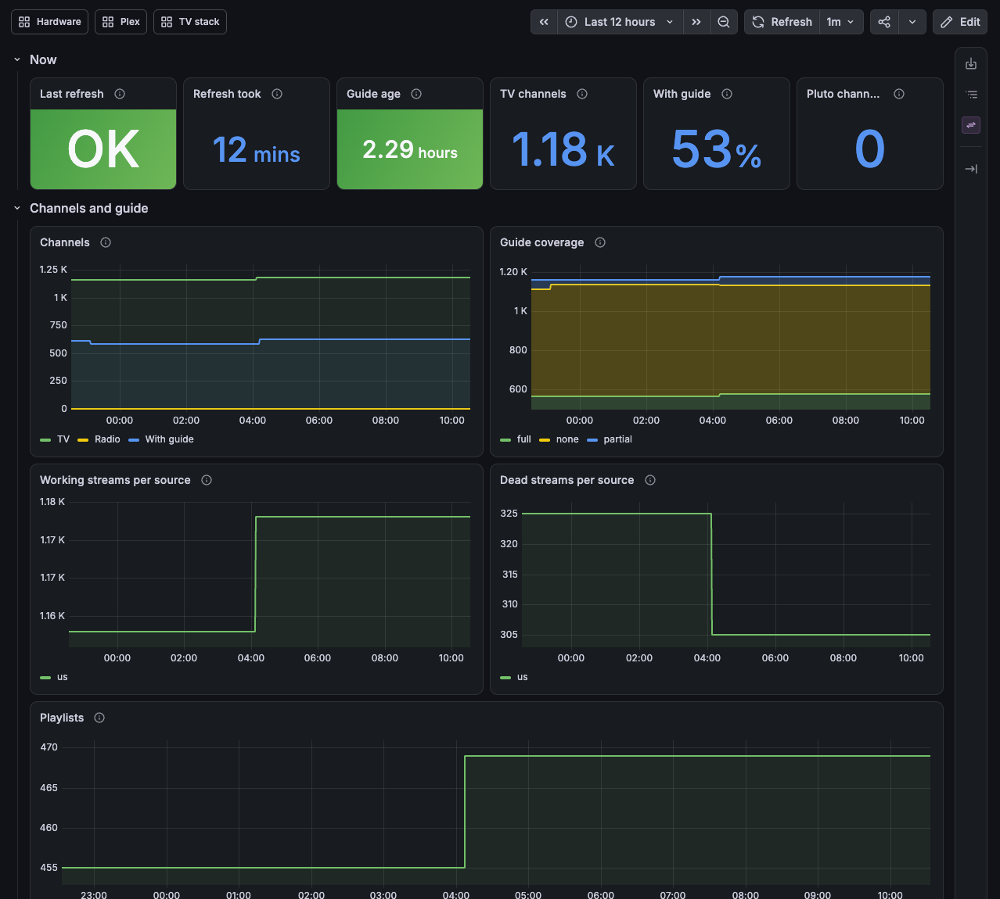
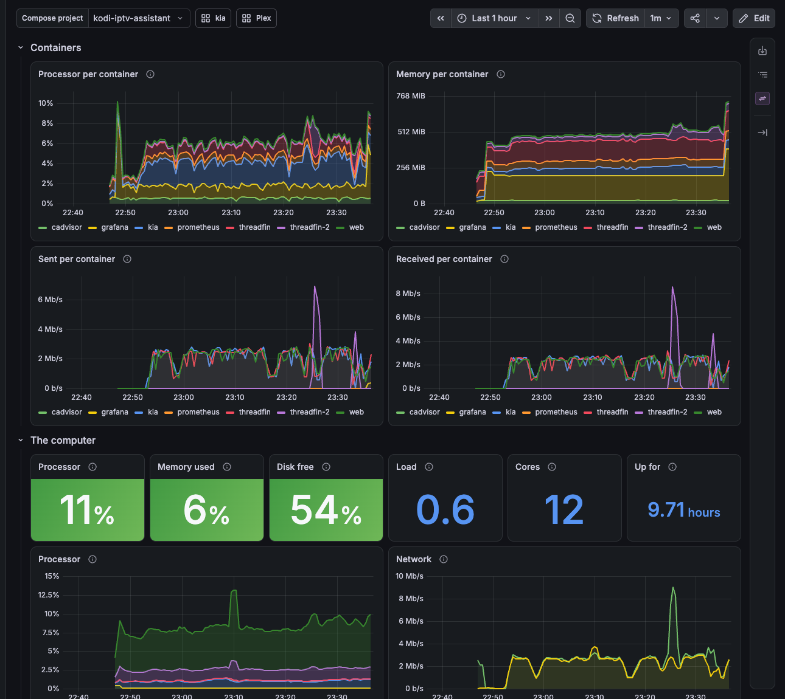

# Graphs for your TV stack: Prometheus and Grafana

kia's Dashboard tells you how things are now. Add Prometheus and Grafana, and you also see how they've been: whether last night's refresh took longer than usual, when a channel source lost half its streams, how busy Threadfin was during the game, and who was watching what on Plex. They run in kia's stack, set up from `.env`, with four dashboards ready to use. Prometheus collects the numbers and keeps them; Grafana draws the graphs. Two small helpers measure the rest: cAdvisor each container, and node-exporter the computer itself.

<picture>
  <source media="(prefers-color-scheme: dark)" srcset="../../images/diagrams/observability-dark.svg">
  
</picture>

| Dashboard | What it shows |
|---|---|
| **kia** | The nightly refresh (OK or failed, how long it took), the guide's age, channels and guide coverage, working and dead streams per source, channels per playlist, the Pluto TV relay's viewers and problems, and kia's own processor and memory use |
| **TV stack** | Processor, memory, and network for each container (kia, the web server, the Threadfins, Plex in the stack), and the computer's processor, memory, disk, and network |
| **Plex** | What's playing now (Live TV, movies, episodes) on each player, whether Plex copies or converts the video (and on the graphics card or the processor), and players away from home. Players show by a pseudonym; the System page tells you which is which |
| **Hardware** | The graphics card (load, video encoder and decoder, temperature), each disk's health, temperatures and fans, software RAID, free space, and a UPS or laptop battery. Each section needs its source: [step 4](#5-the-hardware-dashboard-optional) |



## What you need

- kia running with Docker ([installing kia](../install.md)), or the [home TV box](plex-box.md).
- About 1 GB of disk for 30 days of numbers, and about half a GB of memory, mostly Grafana's (up to 1 GB while it sets itself up the first time).

## 1. Turn it on

In the kia folder, add `monitoring` to `COMPOSE_PROFILES` in `.env`. You can also choose a password for Grafana; without one, Grafana makes one up on its first start (step 3 says where to find it):

```sh
COMPOSE_PROFILES=monitoring
KIA_GRAFANA_PASSWORD=choose-a-password
```

Keep the profiles you already have and put `monitoring` on the end: with Threadfin for Plex, that's `COMPOSE_PROFILES=plex,monitoring`.

## 2. The computer's own numbers

They come from node-exporter on port 9100. How you get it depends on the computer.

### On Linux

If the computer doesn't run node-exporter already, add `monitoring-node` to the profiles: `COMPOSE_PROFILES=monitoring,monitoring-node`. (On Ubuntu or Debian, `systemctl status prometheus-node-exporter` shows whether it's there; if it is, you're set.)

Then start everything:

```sh
docker compose up -d
```

### On a Mac

Docker on a Mac runs in a small Linux machine of its own, so a node-exporter in Docker would measure that machine, not your Mac. Install it on the Mac itself, from [Homebrew](https://brew.sh), in the Terminal:

```sh
brew install node_exporter
brew services start node_exporter
```

It starts with the Mac from then on (`brew services list` shows it), and kia's Prometheus finds it by itself. Leave `monitoring-node` out. Then start everything:

```sh
docker compose up -d
```

## 3. Open Grafana

Go to `https://192.168.1.20:8788`, with your kia's address. Grafana uses kia's own certificate, the same as the [secure Dashboard](../secure-page.md), so your browser warns about it the first time; accept it for this address. Sign in as `admin` with the password from step 1. If you didn't choose one, it's in `monitoring/grafana/admin-password.txt` in the kia folder; on a Mac, `docker compose exec grafana cat /var/lib/grafana/admin-password.txt` shows it ([why](../configuration.md#on-a-mac)). The kia dashboard opens first; the buttons at the top lead to the other three. kia's own Dashboard also gets an **Observability** button that opens it.

The graphs start when Prometheus does, so they fill in over the following hours, and the refreshes over the following nights.



## 4. Plex (optional)

The Plex dashboard reads Plex through kia, with the same settings as [`kia plex-tuners`](../plex.md#4-add-threadfin-to-plex): `KIA_PLEX_URL`, and `KIA_PLEX_TOKEN` for a Plex outside the stack. With Plex in the stack ([home TV box](plex-box.md)), `KIA_PLEX_URL=http://plex:32400` is enough. If those are already in `.env`, there's nothing to do.

Plex installed outside Docker isn't a container, so its processor use shows in the TV stack dashboard's computer section, not per container.

## 5. The Hardware dashboard (optional)

The Hardware dashboard shows the graphics card, each disk's health, temperatures and fans, software RAID, free space, and a UPS or laptop battery. Each section fills in from its own source and stays empty without it, so what you see depends on the computer.

### On Linux

- **Temperatures, fans, RAID, free space, power** come from node-exporter (step 2). Most PCs have the sensors; a UPS connected by USB shows under *Power*.
- **The graphics card:** NVIDIA cards, with [NVIDIA's Container Toolkit](https://docs.nvidia.com/datacenter/cloud-native/container-toolkit/latest/install-guide.html) installed. Add `monitoring-gpu` to the profiles. It shows the card's load and its video encoder and decoder, which Plex uses when it converts video on the card; the Plex dashboard shows which conversions run there and which on the processor.
- **Each disk's health (SMART):** add `monitoring-disks`. It warns about a disk that fails its own check, and counts the sectors a disk has replaced or can't read, numbers that grow as it wears out. To read the disks it runs with full access to the computer (privileged); [security](../../SECURITY.md) explains what each part can do.

For example `COMPOSE_PROFILES=monitoring,monitoring-node,monitoring-gpu,monitoring-disks`, then `docker compose up -d`.

### On a Mac

node-exporter from step 2 fills in free space and power (a UPS or the battery). The rest stays empty: macOS doesn't give node-exporter temperatures or fans, there's no NVIDIA card, and the disk-health exporter can only see Docker's own small Linux machine, so leave `monitoring-gpu` and `monitoring-disks` out.

The dashboard's buttons lead to it from the other three.

## Adding your own

**Other things to collect.** Put a file in `monitoring/targets/` in the kia folder, one per job. For example, a Plex exporter on port 9000 of this computer, `monitoring/targets/plex.yml`:

```yaml
- targets: ["host.docker.internal:9000"]
  labels:
    job: plex-exporter
```

Prometheus picks new files up within a few minutes, without a restart.

**Your own dashboards.** Put Grafana dashboard JSON files in `monitoring/dashboards/`; they appear in Grafana's *Local* folder. Edits you make to kia's four dashboards in Grafana aren't kept, because they're reloaded from kia's files; save a copy (*Save as*) to change one.

## Good to know

- **Ports.** Grafana is on 8788 (`KIA_GRAFANA_PORT`), over HTTPS only. Prometheus is on 8789 (`KIA_PROMETHEUS_PORT`), open to this computer only, because its page has no password. Both stay off the common ports 3000 and 9090, which other programs often use.
- **How long it keeps.** 30 days (`KIA_PROMETHEUS_RETENTION`, such as `90d`). The numbers are in `monitoring/prometheus`, and Grafana's settings in `monitoring/grafana`, in the kia folder (on a Mac, in the Docker volume `grafana-data`).
- **kia's numbers on their own.** kia publishes them at `http://192.168.1.20:8780/metrics` for any Prometheus you already have; [metrics](../metrics.md) lists them.
- **Turning it off.** Remove `monitoring` (and `monitoring-node`, `monitoring-gpu`, `monitoring-disks`) from `COMPOSE_PROFILES`, then `docker compose rm -sf prometheus grafana cadvisor node-exporter dcgm-exporter smartctl-exporter`. On a Mac, `brew services stop node_exporter` too. The numbers stay in `monitoring/` until you delete them.

## If something's wrong

**The computer's graphs are empty.** Nothing is answering on port 9100. On Linux, add `monitoring-node` to `COMPOSE_PROFILES` (step 2); if a firewall runs on the computer, it has to let Docker's network reach port 9100. On a Mac, check that node-exporter runs (`brew services list`) and start it with `brew services start node_exporter`.

**The browser says "Client sent an HTTP request to an HTTPS server".** The address starts with `http://`; use `https://`. Grafana answers only over HTTPS.

**Grafana keeps restarting, or won't start after kia was reinstalled.** It reads kia's certificate from `tls/` in the kia folder, which kia makes when it starts; `docker compose logs grafana` says if a file is missing. Start kia first (`docker compose up -d`).

**Grafana won't start: "address already in use".** Something else has port 8788. Set `KIA_GRAFANA_PORT` to another one, such as `8798`, and run `docker compose up -d`.

**The Plex dashboard says "Not answering".** kia can't reach Plex, or the token is wrong. Check `KIA_PLEX_URL` and `KIA_PLEX_TOKEN` in `.env`; the [Plex guide](../plex.md#4-add-threadfin-to-plex) shows how to find a token. After a change, run `docker compose up -d`.

**The TV stack dashboard has no containers, and its Compose project list is empty.** cAdvisor can't see Docker's containers when Docker keeps its images in containerd, which a new Docker install on Linux does (`docker info` shows `Storage Driver: overlayfs`; older installs show `overlay2`). The computer's own graphs still work. This is a known problem in kia 0.5.4, to be fixed in the next version.

**Forgot Grafana's password, or changed `KIA_GRAFANA_PASSWORD`.** Grafana reads that setting (or makes its `admin-password.txt`) only the first time it starts. Set the one you want, then run `docker compose exec grafana grafana cli admin reset-admin-password "$(grep ^KIA_GRAFANA_PASSWORD= .env | cut -d= -f2-)"`.
