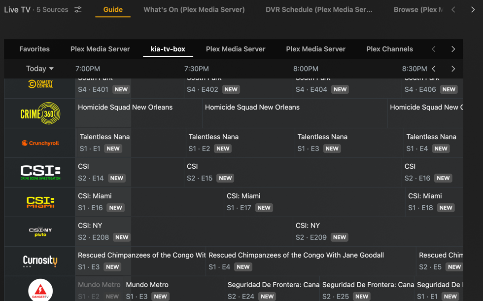
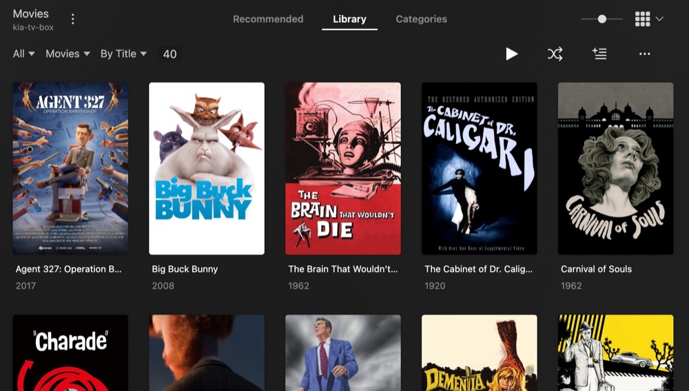

# A home TV box: kia, Threadfin, and Plex in containers

One computer runs everything: kia finds and checks free TV channels and builds their guide, Threadfin presents them as a TV tuner, and Plex Media Server shows them as Live TV in every Plex app, next to your own movies and shows. It all runs in Docker, set up from one settings file, and one command updates it all.

<picture>
  <source media="(prefers-color-scheme: dark)" srcset="../../images/diagrams/plex-box-dark.svg">
  
</picture>

What stays on disk, so nothing is lost when the containers restart or update:

| Folder (in the kia folder) | What's in it | Set in `.env` |
|---|---|---|
| `plex/config` | Plex's settings, database, and artwork (on a Mac, the Docker volume `plex-config`: [why](../configuration.md#on-a-mac)) | `KIA_PLEX_CONFIG` |
| `plex/transcode` | Plex's temporary files while it converts video | `KIA_PLEX_TRANSCODE` |
| `media` | Your movies, shows, and music; Plex can read them but not change them | `KIA_MEDIA_DIR` |
| `threadfin/`, `state/`, `profiles/` | Threadfin's and kia's settings | (always here) |

If Plex already runs on another computer, or outside Docker, use the [Plex guide](../plex.md) instead: it adds kia to the Plex you have.

## What you need

- A computer that stays on, running Linux or macOS with Docker. (On a Mac, Plex in Docker converts video on the processor only, not the graphics chip.) A small PC or an old laptop is enough for Live TV; converting video for your own media takes more.
- A free [Plex account](https://www.plex.tv/sign-up/). Watching Live TV is free; recording needs [Plex Pass](https://www.plex.tv/plex-pass/).
- About 3 GB of disk for kia and Plex, plus room for your media.

## 1. Install kia

Follow [installing kia](../install.md), steps 1 to 6. The quick way is one command, which also asks for this computer's address; this guide uses `192.168.1.20` as the example. Wait for the first refresh to finish: the Dashboard at `http://192.168.1.20:8780/` says when it's done.

## 2. Make the playlist for Plex

Plex takes at most 480 channels from each tuner, so make a playlist of the channels you want in Plex. On the secure Dashboard, `https://192.168.1.20:8743/`, go to **Playlists** and choose **Make a playlist**:

1. Name it `plex`.
2. Choose **Only the channels I pick**, and tick the categories you watch.
3. Under **Plex**, tick **For Plex through Threadfin**.
4. Save, and check the count is 480 or fewer.

For more than 480 channels, make two playlists, `plex-1` and `plex-2`; the [Plex guide](../plex.md#1-make-a-playlist-for-plex) shows how to split them.

## 3. Get a claim code from Plex

A claim code links the new Plex to your account the first time it starts. Sign in at [plex.tv/claim](https://plex.tv/claim) and copy the code, which starts with `claim-`. It works for 4 minutes, so do the next step straight away.

## 4. Turn on Plex

In the kia folder, set these lines in `.env` (they're already in the file, empty; fill those in, because Docker Compose uses the last copy of a line):

```ini
KIA_STACK=plex
PLEX_CLAIM=claim-xxxxxxxxxxxxxxxxxxxx
KIA_PLEX_ADVERTISE=http://192.168.1.20:32400/
```

`KIA_STACK=plex` means Plex in the stack, with Threadfin as its tuner ([the parts you can choose](../stack.md)). For two tuners, use `KIA_STACK=plex,plex-tuner-2`. To use your own media folder (a second disk, say), set `KIA_MEDIA_DIR=/path/to/your/media`. The server is called `kia-tv-box` in Plex apps; `KIA_PLEX_NAME` changes that.

Then start everything:

```sh
scripts/stack.sh apply
docker compose ps
```

`scripts/stack.sh apply` checks your settings first, then sets `COMPOSE_PROFILES` and `KIA_PLEX_URL` and starts Plex and Threadfin.

**Or on the Dashboard.** With the [kia-stack service](../stack-dashboard.md) installed, open the secure page's **Stack** page, choose the **Plex TV box** card, paste the claim code into its box, then choose **Check** and **Apply**. It writes the same lines into `.env`, with `KIA_PLEX_ADVERTISE` from kia's address. A media folder of your own still goes into `.env` as `KIA_MEDIA_DIR` first.

kia sets up Threadfin before it starts, with your playlist, its guide, and the settings that work (see the [Plex guide](../plex.md) for what they are). After a minute or two, `docker compose ps` shows `kia`, `web`, `threadfin`, and `plex`, each `healthy` or `running`.

## 5. Add Live TV to Plex

```sh
docker compose exec kia python3 -m kia plex-tuners
```

```text
Plex hasn't downloaded its codecs yet, which Live TV needs; playing a few seconds of video so it does.
Plex has its codecs now.
Made a new DVR in Plex for kia's Threadfins (DVR 2).
Plex: 442 channels, guide http://threadfin:34400/xmltv/threadfin.xml
Plex is loading the guide now; the channels show under Live TV in a few minutes.
```

kia uses Plex's own sign-in, so there's no token to find. A new Plex downloads its codecs (the parts that read video and sound) only when it first plays a video, and Live TV can't play without them, so the first time, kia plays a few seconds of one of your videos through Plex, or, with no library yet, a 10-second test clip it adds and then removes. From now on, kia brings Plex up to date after each refresh, so new channels arrive in Plex by themselves.

## 6. Watch

Open Plex at `http://192.168.1.20:32400/web`, or any Plex app signed in to your account. The first time, Plex shows a short welcome and asks for the server's name and your libraries; you can skip the libraries for now. Then **Live TV** has your channels and their guide, under `kia-tv-box`.



To add your own movies and shows, put them in the media folder, organized the way Plex likes ([movies](https://support.plex.tv/articles/naming-and-organizing-your-movie-media-files/)), and [make a library](https://support.plex.tv/articles/200288926-creating-libraries/) in Plex. In Plex, the media folder is `/data`.

## Media on a NAS or another server

If you have a NAS or servers with NFS shares, Plex can use the movies, shows, and music on them where they are. `scripts/nfs-media.sh` mounts each share as a folder in one media folder on this computer, read-only, and Plex gets that folder. The shares come back after every restart. Each is mounted when something first reads it, so a server that's off doesn't hold up the computer's startup.

1. On the NAS or server, share the folder over NFS with this computer's address. Read-only is enough. Each NAS names this differently: look for *NFS permissions* or *NFS exports*.
2. On Linux, install NFS first: `sudo apt install nfs-common` (Debian, Ubuntu, Raspberry Pi OS) or `sudo dnf install nfs-utils` (Fedora). A Mac has it already.
3. In the kia folder, add each share with a short name. They can come from different servers:

   ```sh
   sudo scripts/nfs-media.sh add movies nas.local:/volume1/movies
   sudo scripts/nfs-media.sh add shows nas.local:/volume1/tv
   sudo scripts/nfs-media.sh add music 192.0.2.30:/srv/music
   ```

   Each one should say `OK` and how many files and folders it sees.
4. Give the media folder to Plex in `.env`:

   ```ini
   KIA_MEDIA_DIR=/mnt/media
   ```

   On a Mac, it's `KIA_MEDIA_DIR=/Users/Shared/media` (macOS cleans out folders it doesn't know in `/Volumes`, so the script doesn't use it). Then run `docker compose up -d plex`.
5. In Plex, [make a library](https://support.plex.tv/articles/200288926-creating-libraries/) for each share: the `movies` share is the folder `/data/movies`. One library can have several folders, such as shows from two servers.

   

`scripts/nfs-media.sh list` shows the shares and whether each one answers. `sudo scripts/nfs-media.sh remove music` takes one away. Plex only reads media, so read-only is right for it; `--rw` mounts a share that other programs on this computer need to write to. `--base /some/folder` uses another media folder; use the same one every time.

When a server is off, its folder is empty (reading it takes about 10 seconds to give up), and Plex can't see what's on it. Turn off **Empty trash automatically after every scan** in Plex (*Settings → Library*), so a scan while a share is down doesn't remove those items from your libraries. Plex shows them as unavailable until the share is back; **Empty Trash** on a library removes what's really gone.

## Keeping it running

Everything starts again when the computer restarts.

To update kia, follow the steps in the [README](../../README.md#updating-and-stopping), which also update the images, Plex's included. Do it when nobody's watching, because Plex and Threadfin restart. To update only Plex: `docker compose pull plex`, then `docker compose up -d`.

`docker compose exec kia python3 -m kia backup` saves kia's and Threadfin's settings ([backups](../configuration.md#backing-up-and-moving-to-another-computer)). Plex's own settings in `plex/config` can be large; Plex explains [what to back up](https://support.plex.tv/articles/201539237-backing-up-plex-media-server-data/).

## If something's wrong

**Ask kia first.** `docker compose exec kia python3 -m kia doctor plex` checks Threadfin and its playlist, Plex's 480-channel limit, whether kia has added its tuners to Plex, and Plex's codecs, and says what to do about each.

**A share's folder is empty** (`nfs-media.sh` says so, or Plex finds nothing). Check the server is on and the share's path: `showmount -e nas.local` lists what a server shares, and with which addresses. A NAS often allows only the addresses you list, so add this computer's.

**Plex isn't on your account.** The claim code had expired. Get a new one, put it in `PLEX_CLAIM`, and run `docker compose up -d --force-recreate plex`.

**`plex-tuners` says Plex hasn't been claimed yet.** Same as above.

**Plex apps can't connect, or play only at low quality.** Check that `KIA_PLEX_ADVERTISE` has this computer's address and Plex's port, then run `docker compose up -d`.

**Threadfin has no channels.** It started before the playlist existed. Make the playlist (step 2), then run `docker compose restart threadfin`.

For the rest, see the [Plex guide](../plex.md#if-somethings-wrong) and [troubleshooting](../troubleshooting.md).
