# A laptop that travels

Your home server runs kia for the house. A laptop with its own kia and Kodi takes your channels on the road: at home it copies the program guide from the server, and wherever you are, it checks which streams play there.

<picture>
  <source media="(prefers-color-scheme: dark)" srcset="../../images/diagrams/travel-laptop-dark.svg">
  
</picture>

Why the laptop checks streams itself: some channels play only in some countries or on some networks, so the list that works at home isn't always the list that works in a hotel. The guide is the same everywhere, though, and building it is the slow part: on our test laptop, checking the streams took 6 minutes and building the guide 11 more. At home, the laptop copies the server's guide in a few seconds instead.

## What you need

- kia already running on a home server ([installing kia](../install.md)), at an address that stays the same. This guide uses `192.168.1.20`.
- A Mac or Linux laptop.

## 1. Set up kia and Kodi on the laptop

Follow [Kodi and kia on one computer](kodi-computer.md), steps 1 to 3. That gives the laptop its own kia, reachable only from the laptop, and Kodi reading `http://localhost:8780/curated.m3u`.

## 2. Point the laptop at the home server

In the laptop's kia folder, set these lines in `.env`, with your server's address (they're already in the file, empty; fill those in, because Docker Compose uses the last copy of a line):

```ini
KIA_UPSTREAM_URL=http://192.168.1.20:8780
KIA_UPSTREAM_FALLBACK=grab
```

Then apply the change: `docker compose up -d` with Docker, or `scripts/install-service.sh` without.

From now on, the laptop copies the server's guide at each refresh, when it can reach the server.

## 3. Use the same channel sources

The server's guide covers the channels the server reads. If the laptop reads other sources, their channels have no guide. On the laptop's secure Dashboard, `https://localhost:8743/`, open **Sources** and turn on the same sources as on the server. Sources you turn on only on the laptop still work; they just have no guide.

## Away from home

`KIA_UPSTREAM_FALLBACK` decides what happens when the laptop can't reach the server:

| Setting | Away from home | Best for |
|---|---|---|
| `grab` | The laptop builds the guide itself, as a home server does. Each refresh takes longer (11 more minutes on our test laptop) and uses more data. | Trips of more than a couple of days |
| `cached` | The laptop keeps using the last guide it copied. Nothing is downloaded, but the guide covers only about 3 days, so listings run out partway through a longer trip. | Weekends, and slow or metered connections |

Either way, the laptop still checks the streams each night (or when it wakes, if it was asleep), so the channel list fits where you are. Back home, the next refresh copies the server's guide again by itself.

## Tips

- **Hotel networks.** Some block streaming sites. If the channel list comes out much shorter than at home, the network may be why; the list recovers at the next refresh on a better one.
- **What plays here?** After arriving somewhere, open the secure Dashboard, **Sources**, and choose **Check now** on a source. It shows how many of its streams play where you are, without changing anything; the channel list follows at the next refresh.
- **Watching your home server's channels instead.** With a VPN to your home network, such as [Tailscale](https://tailscale.com), the laptop can play the server's playlist directly; see [away from home](../players.md#away-from-home). Your player still fetches the streams from where you are, so a laptop with its own kia gives the same channels without the VPN.

## If something's wrong

**Refreshes at home take as long as away.** The laptop can't reach the server, so it builds the guide itself (its log says "Falling back to grabbing the guide locally"). Open `http://192.168.1.20:8780/` on the laptop: if it doesn't load, check the server is running and that the address in `KIA_UPSTREAM_URL` is right.

**Many channels have no guide.** The laptop reads sources the server doesn't (step 3).

**The guide ran out on a trip.** That's `cached` after about 3 days. Switch to `grab` and apply the change, and the next refresh builds a new guide.

For the rest, see [troubleshooting](../troubleshooting.md).
