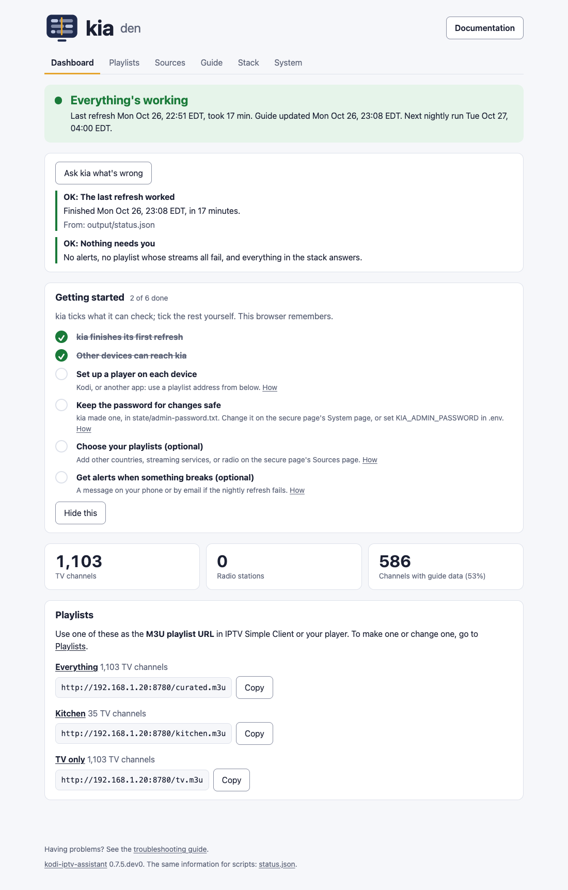

# How it works

Every night (`KIA_RUN_AT`), kia runs four steps, and it refreshes the guide every few hours in between ([details](#4-build-the-guide-kia-guide)). You can also run them by hand, e.g. `docker compose exec kia python3 -m kia check`.

## 1. Check streams (`kia check`)

Every stream in your playlists is opened with `ffprobe`. A TV stream counts as working if it opens and has video; a radio station needs only audio. Some servers turn away anything that isn't a media player, or more than a couple of connections from one place, so kia introduces itself as VLC (the player most widely accepted), tests at most two streams per server at a time, and starts tests on the same server at least a tenth of a second apart. jmp2.uk, which carries about 750 Pluto TV, Samsung TV Plus, and Plex streams, allows six at a time (`per_host_limits`). Streams that fail a name lookup or time out get a second, slower try before they count as failed. Only network addresses (`http`, `https`, `rtmp`, `rtsp`) are tested; anything else in a playlist, such as a file on this computer, is marked dead.

kia writes the same identity into the playlist, so Kodi plays each stream the way kia tested it. Some servers turn Kodi's own identity away, including the one that carries the Pluto TV, Samsung TV Plus, and Plex channels. Pluto TV channels are the exception: kia plays those itself ([Pluto TV](#pluto-tv)).

Each stream is marked:

- ok: works now.
- flaky: failed tonight but worked before, and hasn't failed more than `grace_failures` nights in a row. It stays in the list, because free streams often drop out for a while.
- dead: everything else.

Channels listed more than once (same `tvg-id`) are reduced to the best stream: working beats flaky, then higher resolution, then faster response.

Different playlists often list the same channel under different IDs: CBS News 24/7 is in both iptv-org's USA list and the Samsung TV Plus list, for example. kia joins channels with exactly the same name from different playlists into one (`merge_duplicates`). The merged channel keeps the ID, logo, and number from the earliest playlist in your sources list, and plays whichever copy's stream tested best. Its guide can come from any of the copies. A name that one playlist uses for two channels, such as "FOX 5" for two cities, isn't merged.

Each channel kept gets a number (`tvg-chno`) the first time and keeps it, so numbers don't shift when other channels come and go. The list is in alphabetical order, with your [favorites](configuration.md#favorites-and-your-own-channel-numbers) first. The result is `curated.m3u`. `report.html` shows the counts, common failures, and every channel kept.

### Radio

Lines starting with `radio-browser:` in `sources.txt` ask [radio-browser.info](https://www.radio-browser.info), a free community directory, for its most popular working stations that match your choices, such as a country, genre, language, or station name. Stations listed more than once are merged, keeping the best stream. They're tested like TV channels and marked as radio in the playlist, so Kodi shows them under Radio. Almost no radio station has guide data, so they get no placeholder blocks unless you turn on `KIA_RADIO_PLACEHOLDERS`. The exception so far is KINK, from the Netherlands: kia reads the schedule on kink.nl for a station named exactly "KINK", so its shows and DJs appear in Kodi's radio guide. KINK's theme channels play non-stop and have no schedule.

## 2. Match channels to guide sources (`kia map`)

Kodi connects a channel to its guide by ID. Playlists from iptv-org use IDs like `CNN.us@East`; guide sites use their own. [iptv-org/epg](https://github.com/iptv-org/epg) keeps a table linking the two for thousands of channels. kia looks up each working channel in it (same feed first, then other feeds of the same channel), skips sites marked broken, and keeps up to three candidate sites per channel.

This is also why guides built by hand are often nearly empty: the channel lists generated by iptv-org/epg's tools leave the ID blank, so nothing matches.

Guide sites also list many channels iptv-org hasn't linked to an ID, and channels get renamed. So when no site lists a channel's ID, kia looks for a site channel with exactly the same name in the same country. A wrong match would show another channel's programs, so a name counts only if it belongs to one channel. Looser matches, like "CBN News" and "CBN News Channel", are listed for you to check and never used. `mapping-report.html` lists the channels matched by ID, those matched by name, the possible matches, and the channels with no guide source. If a name match is wrong, add the channel's tvg-id to `ignore_name_matches` in `kia.toml`; to use a possible match you've checked, add it to `accept_name_matches`.

Some playlists name their own guide in their first line (`x-tvg-url`), with channel IDs that match the playlist's. The Samsung TV Plus list in `sources.txt` does, for example. kia adds that guide to the sources it compares for the playlist's channels, and prefers it when two sources cover the same hours. Set `playlist_guides = false` under `[epg]` in `kia.toml` to leave them out.

## 3. Download guide data (`kia grab`)

kia first updates its copy of iptv-org/epg to the latest version (or the one you've pinned; see [versions](configuration.md#versions)). If GitHub can't be reached, it uses the copy it has. For each candidate site, kia runs iptv-org/epg's downloader, a few sites at a time. Some sites allow many requests at once and some only one at a time, so `site_connections` and `site_delay_ms` in `kia.toml` set those per site. Guides named by playlists are downloaded too, keeping only the channels in your list. If a site or guide fails, or takes longer than `site_time_limit` (30 minutes), its previous data is kept. i.mjh.nz (Pluto TV, Plex, Samsung TV Plus, Roku) publishes complete guide files, so kia reads those directly. That takes seconds and about 40 MB of memory, instead of about 25 minutes and over 2 GB.

## 4. Build the guide (`kia guide`)

For each channel, kia picks the site with the most programs in the next 24 hours and writes `guide.xml` and `guide.xml.gz`. Programs without a title don't count, because some sites send only times, and neither does a site with nothing in the next 24 hours (only old listings, for example). Channels with no data get blocks showing the channel's name (`placeholders`). A damaged guide file is skipped, and the other sites are still used. `guide-report.html` shows coverage by channel and site.

Some guides list only the next few hours; i.mjh.nz's Samsung TV Plus guide, for example, reaches about 11 hours ahead. So between nightly runs, kia refreshes the guide every 4 hours (`KIA_GUIDE_REFRESH_HOURS`): it downloads the guides it reads itself again (i.mjh.nz, kink.nl, and the playlists' own guides), which takes seconds, and rebuilds the guide with the sites from the night before. When a channel's listings still run out before the end of the guide, the rest of its row shows the channel's name.

With an upstream server (`KIA_UPSTREAM_URL`), kia skips steps 2 and 3: it downloads the upstream's guide and keeps the channels in its own list. If the upstream can't be reached, it falls back to steps 2 and 3 (or the last copy, with `KIA_UPSTREAM_FALLBACK=cached`).

## Pluto TV

Pluto TV's live streams break most players at ad breaks. The picture goes black or freezes and comes back only when you start the channel again, or the show jumps back a few minutes, sometimes into the ads you just watched. kia found three causes:

- The usual Pluto links (`jmp2.uk/plu-…`) open sessions that leave the ads to the player. Players don't put in ads, and in kia's tests these sessions drifted away from Pluto's schedule, then jumped back minutes at a time.
- At ad breaks, Pluto's playlist sometimes repeats pieces, sends them out of order, or moves to the next ad without marking the change. Its numbering jumps around too.
- Every ad, and every part of a show, starts its own clock. Many players lose the picture or the sound when the clock starts over.

So kia plays Pluto channels itself. The playlist points each Pluto channel at kia (`http://<your address>:8780/pluto/<id>.m3u8`), and when a player opens one, kia:

- opens its own session with Pluto, with Pluto putting in the ads, and gets a fresh one about every 8 hours, as Pluto asks, at an ad break so the switch doesn't show;
- keeps its own list of the channel's pieces in time order, leaves out repeats and pieces Pluto already sent, and opens a new session if Pluto goes back;
- copies each piece onto one steady clock, so players never see it start over. ffmpeg only copies (it doesn't re-encode), so this is light work.

kia fetches each piece from Pluto when a player first asks for it, so it uses about as much of your internet connection as watching Pluto directly. Everyone watching a channel shares its session and its pieces, and kia lets a channel go two minutes after the last player stops. When Pluto goes back to pieces kia already sent, kia waits for new ones instead of playing them again, so the picture can pause for up to half a minute. If Pluto won't open a session, kia plays Pluto's plain link instead, which may freeze at breaks, and tries again every five minutes. Timeshift (pausing and rewinding live TV) keeps working, because it happens in the player.

The playlist uses the address in `KIA_PUBLIC_URL` for Pluto channels, so every device that plays them must be able to reach it; when it isn't set, Pluto channels keep their own links. `KIA_PLUTO_RELAY=false` in `.env` turns this off, and the playlist then has Pluto's own links. While Pluto channels play, the status page's Details page shows each one, its session, and any recent problems. The same is in `pluto.json` for scripts.

## The status page

`http://<your address>:8780/` shows how kia is doing: whether the last refresh worked and when the next one is, the channel counts, and the last run's alerts. Below that are your playlists, the full one and any [profiles](profiles.md), each with its address and a Copy button, and links to these docs. kia updates the page when a run starts and ends, and when you save a profile.

Each playlist has its own page with its playlist and guide addresses and a list of its channels, with their numbers and categories, what's on now, and what's next. **Next 6 hours** switches the list to a timeline, like a TV guide. The times are in your device's time zone. A profile's page also has **Edit this playlist**. On the secure page, each channel has a star for [favorites](configuration.md#favorites-and-your-own-channel-numbers), and on Everything you can change its number. The **Details** page has the guide coverage, how each source playlist's streams are doing, the full reports, the [Pluto TV](#pluto-tv) channels playing right now, the playlists kia checks (on the secure page, where you can [choose them](configuration.md#choosing-playlists-on-the-status-page)), and the settings kia is running with, each with where to change it (`.env` or `kia.toml`). Passwords and alert addresses show only whether they're set.



The banner at the top shows the state of the last refresh:

| Banner | Meaning |
|---|---|
| Refreshing now | A run is going. The numbers are from the last run until it finishes. |
| Everything's working | Nothing needs you. |
| Working, with alerts | The playlist and guide were updated, but something needs a look. The alerts are listed further down the page; [troubleshooting](troubleshooting.md#alerts) says what to do about each. |
| The last refresh failed | The playlist or guide may not have been updated. See [the refresh failed](troubleshooting.md#the-status-page-says-the-refresh-failed). |
| Waiting for the first refresh | kia's first run hasn't finished. It can take up to an hour. |

On the Details page, bars show how many TV channels have a full guide, a partial one, or only their name, and how many streams in each source playlist work.

### `status.json`

The same information, for scripts and monitoring tools such as Uptime Kuma or Home Assistant, is at `http://<your address>:8780/status.json`. The [API guide](api.md) covers everything else scripts can read and change.

| Field | Contents |
|---|---|
| `result` | `running`, `ok`, `alerts`, `failed`, or `never` |
| `last_run` | `started` and `finished` (UTC times), `minutes`, and `exit_code` (0 worked, 3 worked with alerts, anything else failed) |
| `next_run` | The next nightly run, in local time with its UTC offset |
| `guide_updated` | When the guide was last rebuilt, by a nightly run or a quick refresh (UTC) |
| `channels` | `tv`, `radio`, and `with_guide` (channels with guide data) |
| `coverage` | TV channels with a `full` guide (20 or more of the next 24 hours), a `partial` one, or `none` |
| `sources` | For each playlist: its `name`, and how many of its streams are `ok`, `flaky`, and `dead` |
| `alerts` | The last run's alerts: `time`, `event` (see [alerts](alerts.md)), and `title` |
| `playlist_url` | The playlist address for Kodi |
| `profiles` | Each [profile](profiles.md) playlist: `name`, `title`, `file`, `tv` and `radio` counts, its `url`, and its own `guide` file |
| `profiles_error` | The mistake in the profiles file, if it has one |
| `secure` | The [secure status page](secure-page.md): its `url`, and its certificate (`tls`: `names`, `expires`, `issuer`, whether kia `generated` it, and whether its key matches) |
| `settings` | The settings kia is running with, in sections (`title`, `rows`), each row with its `name`, `value`, and where to `change` it. Secrets show only `set` or `not set`. |
| `pluto_channels` | The Pluto TV channels in the playlist that play through kia, by Pluto channel ID, with their names |
| `files` | The files in the output folder |
| `version` | kia's version |

### `pluto.json`

The [Pluto TV](#pluto-tv) channels playing through kia right now, at `http://<your address>:8780/pluto.json`. kia rewrites it every minute while it runs, and whenever a player asks for a channel (at most every 15 seconds).

| Field | Contents |
|---|---|
| `updated` | When kia wrote it (UTC) |
| `channels` | Each channel playing: its Pluto `id`, `viewers` (devices that asked for it in the last 30 seconds), `own_session` (false when kia is on Pluto's plain link), `session_started`, `session_hours`, `next_refresh_hours`, `suspicious` (Pluto flagged the session), `fallback_minutes` (how long on the plain link), and counts since the channel started playing: `rewinds` (times kia caught Pluto going back), `sessions`, `errors`, `fallbacks`. `problems` lists the last few, each with its `time` and `text`. |
| `suspicious` | Pluto has flagged one of kia's sessions |
| `fallback` | A channel has been on Pluto's plain link for 5 minutes or more |

A monitor should warn you when `result` is `failed`, and when `last_run.finished` is more than a day old, which means kia stopped running. For example, as a shell check that fails in either case:

```sh
curl -s http://192.168.1.20:8780/status.json | python3 -c '
import json, sys
from datetime import datetime, timedelta, timezone
s = json.load(sys.stdin)
done = s["last_run"]["finished"]
stale = not done or datetime.now(timezone.utc) - datetime.fromisoformat(done) > timedelta(hours=26)
sys.exit(1 if s["result"] == "failed" or (stale and s["result"] != "running") else 0)'
```

## DNS checks and alerts

When a stream or guide site's name can't be looked up, kia asks public DNS servers (`[dns] verify_resolvers`) as well. If they can't find it either, the stream or site is gone, and kia just reports it. If they can, your network's DNS is the problem (an ad-blocker or the router, for example), and since that would affect Kodi too, kia raises an alert. If kia can't reach them either, a moment without internet is more likely than a DNS problem, so kia only notes it in the log. Names are tried twice on your network first, so a single slow lookup doesn't raise one. Some sites' own DNS servers send broken IPv6 answers, which make the lookup fail everywhere; kia recognizes that and reports it as the site's problem, not yours.

Alerts also cover a failed nightly run, sharp drops in working channels or guide coverage, and a guide site that keeps failing. They can go to your phone through ntfy or to any command you choose: see [alerts](alerts.md).

## Files

| Folder | Contents |
|---|---|
| `output/` | What gets served: the playlist, guide, reports (each as `.html` for browsers and `.md`), the profiles' playlists and guides (`<name>.m3u`, `<name>.guide.xml.gz`), and the status pages (`index.html`, `details.html`, one per playlist in `playlists/`, and `status.json` for scripts), and `pluto.json` while Pluto TV channels play |
| `state/` | Stream history, channel numbers, the alert log, and the choices made on the status page: playlists (`sources.json`), favorites and numbers (`channels.json`) |
| `work/` | Intermediate files: per-site channel lists, downloaded guides, logs |
| `vendor/epg/` | kia's copy of iptv-org/epg, updated nightly |

Deleting `work/` or `vendor/` is safe; they're rebuilt on the next run. Deleting `state/` resets stream history.
