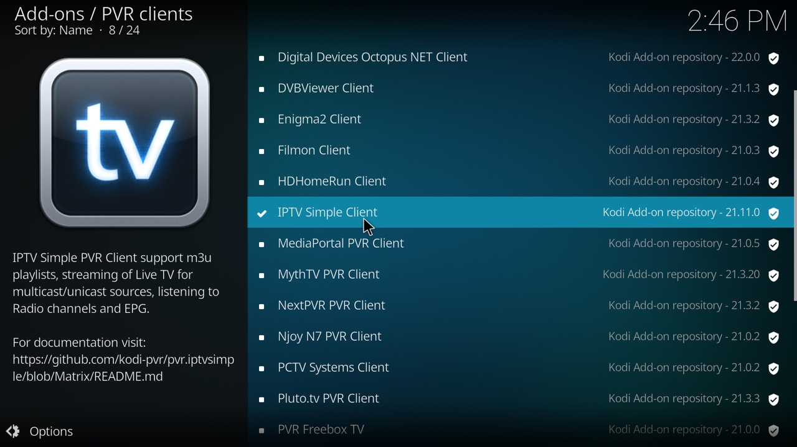
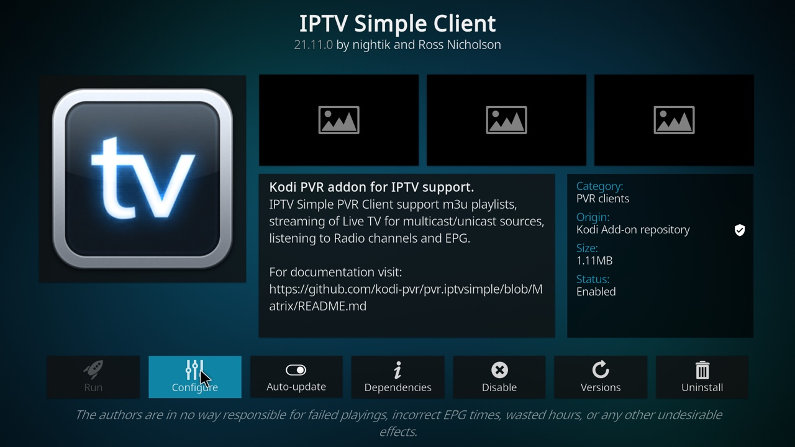
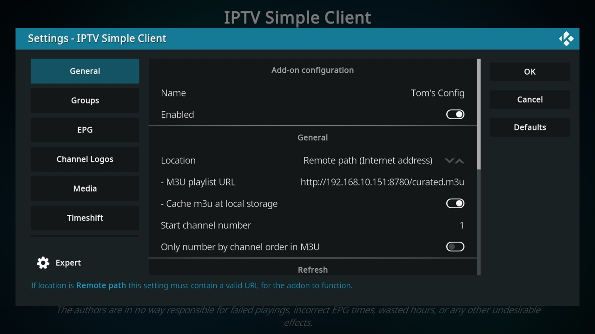
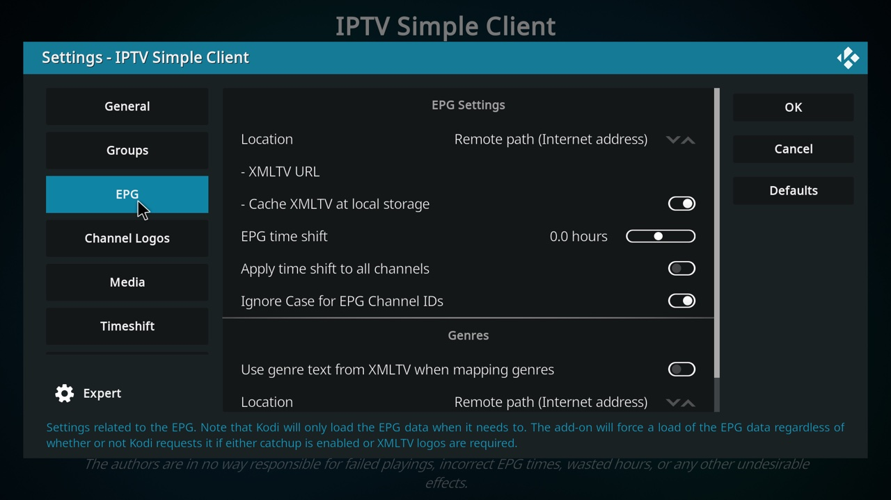

# Setting up Kodi

Do this once on each Kodi device. After that, the channel list and guide update by themselves.

You need the address of the machine running kia, e.g. `http://192.168.1.20:8780` (the `KIA_PUBLIC_URL` from your `.env`). Check it first: opening `http://192.168.1.20:8780/curated.m3u` in a browser on the same network should download a file.

## 1. Install Kodi

Get it from [kodi.tv/download](https://kodi.tv/download/), which has instructions for each platform:

- Windows, macOS, Linux: download the installer (on Linux, often from your distribution's package manager or Flathub).
- Android phones, tablets, Android TV, Google TV, Nvidia Shield: Google Play Store.
- Amazon Fire TV: Kodi isn't in Amazon's store. Install it with the free *Downloader* app; kodi.tv's Android page and the [Kodi wiki](https://kodi.wiki/) walk through it.
- Raspberry Pi or a dedicated TV box: [LibreELEC](https://libreelec.tv/) is a ready-made system that boots straight into Kodi.
- Apple TV and iPhone: possible, but it needs sideloading; see the Kodi wiki.

## 2. Install IPTV Simple Client

*Settings → Add-ons → Install from repository → PVR clients → IPTV Simple Client → Install.*

## 3. Point it at the playlist

Open the add-on (*Settings → Add-ons → My add-ons → PVR clients → IPTV Simple Client*) and choose **Configure**.

On the **General** tab, set:

- **Location:** Remote path (Internet address)
- **M3U playlist URL:** your kia address followed by `/curated.m3u`, e.g. `http://192.168.1.20:8780/curated.m3u`

The **Name** at the top is just a label for this setup; anything works.

On the **EPG** tab, leave **XMLTV URL** empty. The playlist tells Kodi where the guide is. (If your Kodi doesn't pick the guide up, enter `http://192.168.1.20:8780/guide.xml.gz` there, with your address.)

## 4. Restart Kodi

Restart Kodi (or disable and re-enable the add-on). Channels appear under TV, and the guide fills in within a minute or two. Channels without guide data show their own name in the guide, like IraneFarda TV and It Is Written TV below.

## Troubleshooting

- No channels? Open the playlist URL in a browser on the same network. If it doesn't download, check `KIA_PUBLIC_URL` and `KIA_BIND=0.0.0.0` in `.env`, and that your firewall allows the port.
- Channels but no guide? Give it a couple of minutes, then restart Kodi. Some channels have no guide data anywhere and show their own name instead of programs. `http://<address>:8780/guide-report.md` lists coverage.
- A channel won't play? Free streams come and go. The nightly check drops streams that stay broken.
- Old or mixed-up channels, for example after changing playlists? Clear Kodi's TV data: *Settings → PVR & Live TV → General → Clear data → All → OK*. Kodi reloads everything from kia within a minute or so.

