# Plex and Threadfin under the hood

What happens between kia's playlist and Plex's Live TV: how Threadfin gets its settings, how kia adds the tuners to Plex and keeps them up to date, and why a new Plex in kia's stack plays a few seconds of video by itself. To set it up, see [Plex](plex.md) or [the home TV box](cookbooks/plex-box.md). Read this one to see how the pieces connect, or when Plex and kia disagree.

## The pieces

| Piece | Where | What it does |
|---|---|---|
| Plex's playlist | `output/plex.m3u` (or `plex-1.m3u` and `plex-2.m3u`) | A [profile](profiles.md) with **For Plex through Threadfin** ticked, which writes an apostrophe in a name as ’, since Threadfin misreads `'` |
| Its guide | `output/plex.guide.xml.gz` | The full guide cut down to that playlist's channels |
| threadfin-setup | a one-off container | Writes each Threadfin's first settings, then exits |
| Threadfin | container `threadfin`, port 34400 (`threadfin-2`, 34401) | Reads the playlist and guide, and shows them to Plex as an HDHomeRun tuner |
| Threadfin's settings | `threadfin/conf/` (`threadfin-2/conf/`) | Its settings, its login, and its password, `admin-password.txt` |
| `kia plex-tuners` | inside kia | Adds the Threadfins to Plex as one DVR, and keeps its channels up to date |
| Plex | container `plex` with the `plex` part, or your own | Plex Media Server |

Plex does live TV only through tuners, and takes at most 480 channels from each. So one Threadfin carries up to 480 channels, and a second carries the next 480.

<picture>
  <source media="(prefers-color-scheme: dark)" srcset="../images/diagrams/plex-wiring-dark.svg">
  
</picture>

## Threadfin's first start

Threadfin set up by hand has a trap: channels it sees before it has the guide never get matched to the guide later. So before Threadfin first starts, the `threadfin-setup` container writes its settings with everything in place at once:

- the playlist, `http://web/plex.m3u`, from kia's web server over Compose's own network (`plex-1` when there's no `plex`, `plex-2` for the second; `KIA_THREADFIN_PLAYLIST` chooses another)
- the playlist's own guide, `http://web/plex.guide.xml.gz`
- a filter that passes every channel, since Threadfin passes on only the channels a filter picks
- the guide source set to XEPG (Threadfin's own matching of channels to guide entries), and 4 tuners
- FFmpeg options that pass on one stream, copied, not re-encoded
- updates at 00:00, 06:00, 12:00, and 18:00, so the day's new channels and listings reach Threadfin

Threadfin's page has no login by default, so anyone on your network could change its playlist or FFmpeg settings. threadfin-setup gives it one: the user `admin`, with a random password saved in `threadfin/conf/admin-password.txt`, readable only by you. Plex's access (the tuner, the playlist, and the guide) stays open, as Plex needs.

A Threadfin that already has settings keeps them: threadfin-setup only adds the login, if it has none. Changes you make on Threadfin's own page stay.

## Adding the tuners to Plex (`kia plex-tuners`)

Plex's own setup page adds a tuner only when Plex has no DVR yet, and won't give an XMLTV guide to a DVR that uses Plex's own guide (an antenna tuner's, say). So kia talks to Plex's API directly, making the same calls as Plex's web page. For each running Threadfin, kia:

1. Asks Threadfin for its channel list (`lineup.json`). A Threadfin that doesn't answer, or has no channels yet, is left out.
2. Registers it with Plex as an HDHomeRun tuner. Plex knows a tuner by its device ID, so this finds one Plex already has.
3. Looks for a DVR that already has one of kia's tuners, and makes one if there's none. Any other DVR, such as an antenna's, is left alone.
4. Adds the tuner's guide to the DVR (`http://<Threadfin>/xmltv/threadfin.xml`), if the DVR doesn't have it yet.
5. Turns on every channel, each matched to the same number in the guide, so running it again adds the channels the playlist gained.
6. Names the tuner after the kia playlist it carries.

Then it asks Plex to load the guide again. Where kia finds Plex and Threadfin:

| | Plex in kia's stack | Your own Plex |
|---|---|---|
| Plex's address | `http://plex:32400`, which `scripts/stack.sh apply` sets as `KIA_PLEX_URL` | `KIA_PLEX_URL` |
| Plex's token | the one Plex saved when it was claimed, which kia reads from Plex's settings | `KIA_PLEX_TOKEN` |
| Threadfin's address, as Plex sees it | `threadfin:34400` and `threadfin-2:34400` on Compose's network | the host in `KIA_PUBLIC_URL`, with `KIA_THREADFIN_PORT` and `KIA_THREADFIN_2_PORT` |

A new Plex answers before it accepts changes; for its first minutes it turns them away as "still starting up". kia waits for it, up to 5 minutes.

With `KIA_PLEX_URL` set, kia runs this after each nightly refresh and each quick guide refresh, so channels the playlist gained reach Plex the same day. `kia plex-tuners --remove` deletes the DVR, but only when it holds nothing but kia's Threadfins.

## The codec warm-up

A new Plex has no codecs. It downloads them the first time it plays a video, and Live TV alone never makes it: Live TV only copies the stream, but reading the sound's sample rate needs Plex's AAC codec, so every channel fails with "Could not tune channel". So with Plex in kia's stack, before `kia plex-tuners` adds the tuners, kia checks Plex's codec folder, and if the AAC codec isn't there, plays something for a moment:

1. A movie or episode from your libraries with AAC sound, if Plex has one, through Plex's transcoder.
2. Otherwise, a 10-second test clip kia makes with ffmpeg in `plex/warmup/`. kia adds it to Plex as a library called "kia codec warm-up", plays it, then deletes the library and the clip. Plex scans one library at a time, so if it's busy scanning yours, kia waits, up to 20 minutes.

kia stops as soon as the codec arrives. After a refresh it tries this at most once a day; run by hand, every time. Playing any video in Plex does the same.

## How a change travels

| What changed | How it reaches Plex |
|---|---|
| Tonight's check kept new channels | The playlist changes at once; Threadfin reads it at its next update (every 6 hours); with `KIA_PLEX_URL`, `kia plex-tuners` turns them on in Plex after the refresh |
| A quick guide refresh | Threadfin reads the guide at its next update; with `KIA_PLEX_URL`, kia asks Plex to load the guide again after the refresh |
| You edited the `plex` playlist on the Dashboard | Written at once; from there, the same as new channels |
| You changed Threadfin's settings on its page | Kept; kia never rewrites them |

**Refresh Guide** on Plex's Live TV & DVR page loads the guide right away.

## When something doesn't line up

| What you see | Where to look |
|---|---|
| "Could not tune channel" on every channel, Plex in the stack | The codec warm-up: kia's log says whether it ran. Play any video in Plex, then try again |
| Some channels in Threadfin but not in Plex | `kia plex-tuners` hasn't run since: is `KIA_PLEX_URL` set? Its log lines start with the tuner's name |
| kia says Threadfin "isn't answering" | `docker compose ps`: is Threadfin healthy? For your own Plex, can it reach the address in `KIA_PUBLIC_URL`? |
| "check the token" | `KIA_PLEX_TOKEN` is wrong or expired (your own Plex), or Plex in the stack isn't claimed yet |
| Channels with no guide in Threadfin | Threadfin saw them before the guide; [Plex](plex.md#if-somethings-wrong) shows how to have it start over |
