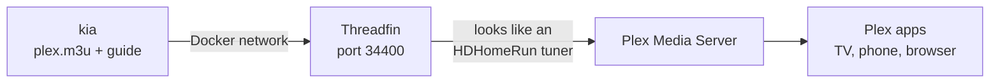
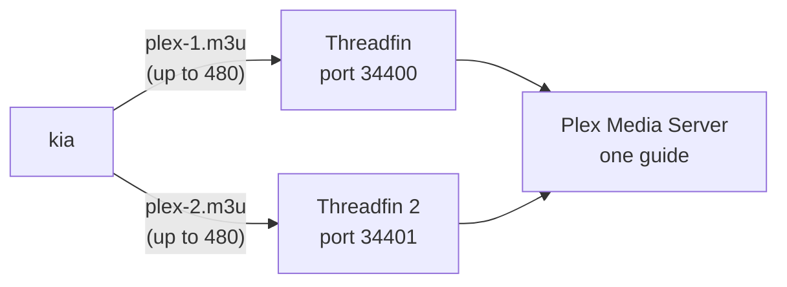
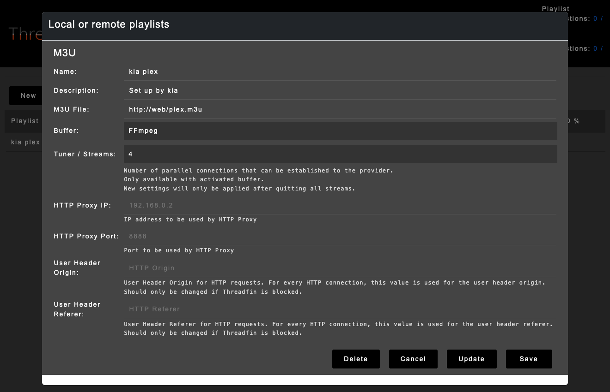
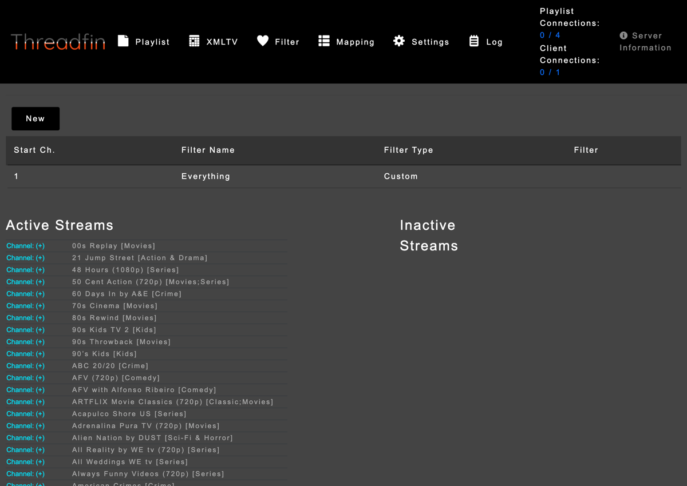
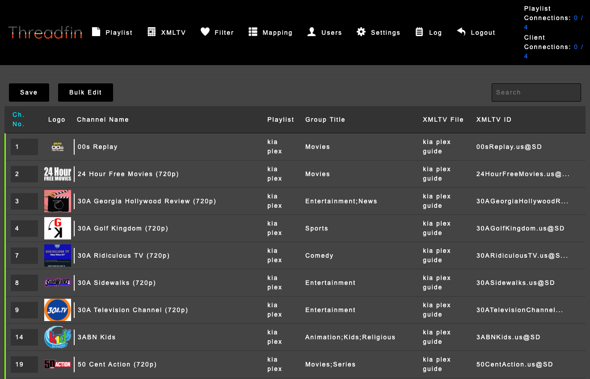
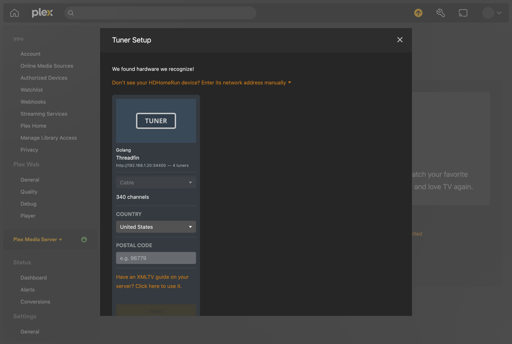
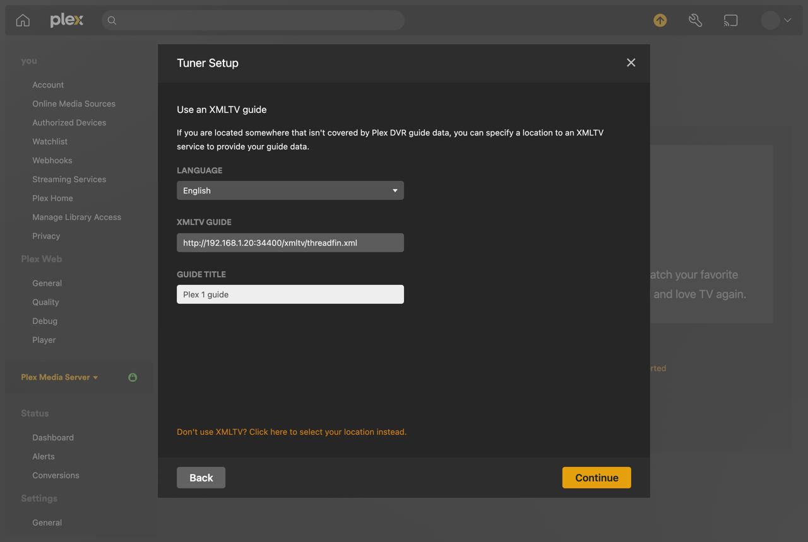
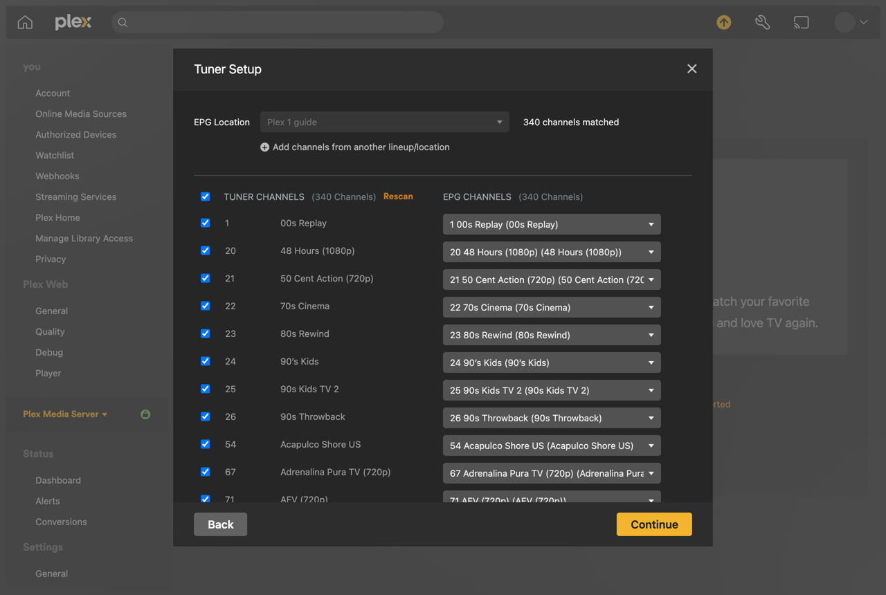
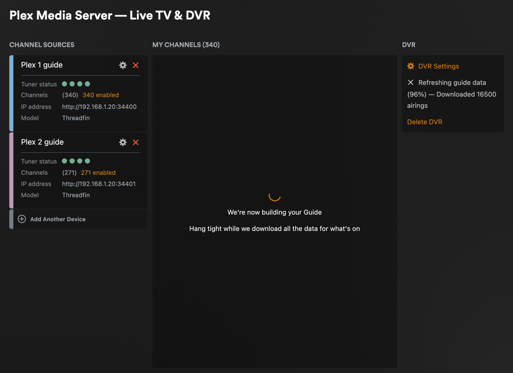

# Plex

Plex can't open a playlist by itself. It does live TV through tuners such as the HDHomeRun, so kia runs a small free program next to it, [Threadfin](https://github.com/Threadfin/Threadfin), that shows kia's playlist and guide to Plex as an HDHomeRun tuner. Threadfin starts and stops with kia, keeps its settings in the kia folder, and is included in [kia's backups](configuration.md#backing-up-and-moving-to-another-computer). These steps were tested with Threadfin 1.2.37 and Plex Media Server 1.43.

Plex says watching through a tuner is free, and recording (DVR) needs [Plex Pass](https://www.plex.tv/plex-pass/). Plex changes its plans from time to time, so check its [Live TV & DVR](https://support.plex.tv/articles/225877347-live-tv-dvr/) page.



## Before you start

- kia running with Docker Compose ([install](install.md)).
- Plex Media Server on a computer in the same home network. It can be the kia computer or another one, installed any way you like (a package, an app, or a container).
- An idea of how many channels you want in Plex. **Plex takes at most 480 channels from each tuner.** Up to 480, you need one Threadfin. For more, run two, each with its own playlist; Plex shows both tuners' channels together in one guide.



## 1. Make a playlist for Plex

A shorter list is quicker for Plex to load and easier to browse. On kia's secure page ([how to open it](profiles.md)), choose **Make a playlist**:

1. Name it `plex`.
2. Choose **Only the channels I pick** and tick the categories you watch, such as News, Movies, and Sports.
3. Under **Plex**, tick **For Plex through Threadfin**. Threadfin misreads channel names that have an apostrophe, such as "Hogan's Heroes", so this writes them with a curly one (’) instead.
4. Save, and check the channel count is 480 or fewer.

For two tuners, make two playlists named `plex-1` and `plex-2`, each with **For Plex through Threadfin** ticked and 480 channels or fewer. Split the categories between them. A channel can belong to more than one category, so in `plex-2`, also leave out the categories you picked for `plex-1`; that keeps each channel on one tuner. In a [profiles file](profiles.md), `exclude_channels` does the same for single channels.

## 2. Start Threadfin with kia

In kia's folder, add this line to the `.env` file:

```sh
COMPOSE_PROFILES=plex
```

For two tuners, write `COMPOSE_PROFILES=plex,plex-2` instead. Then start it:

```sh
docker compose up -d
docker compose ps
```

`docker compose ps` lists `threadfin` (and `threadfin-2`) next to kia, and after a minute each says `healthy`. From now on Threadfin starts whenever kia does, including after the computer restarts. Its settings are kept in the `threadfin/` folder (and `threadfin-2/`).

Threadfin's page is at `http://<your address>:34400/web/`, and the second one's is at port 34401. To use other ports, set `KIA_THREADFIN_PORT` and `KIA_THREADFIN_2_PORT` in `.env` ([settings](configuration.md)).

## 3. Set up Threadfin

Open `http://<your address>:34400/web/`. Do these steps in this order: Threadfin matches each channel to the guide when it first sees the channel, so the guide has to be in place before step 4.

**1. Playlist → New.** Choose **M3U** and **Next**, then fill in:

| Field | What to enter |
|---|---|
| Name | `kia plex` |
| M3U File | `http://web/plex.m3u` |
| Buffer | **FFmpeg** |
| Tuner / Streams | `4` (how many channels can play at once) |

`web` is kia's own name on Docker's network, so this address keeps working even if the computer's address changes. Choose **Save**.



**2. XMLTV → New.** Name it `kia plex guide`, enter `http://web/plex.guide.xml.gz` as the XMLTV file, and choose **Save**. Threadfin takes a few seconds to read the guide.

**3. Filter → New.** Threadfin only passes on channels that a filter picks. Choose **Custom Filter** and **Next**, name it `Everything`, type a single space in **Filter** (it matches every channel kia writes), and choose **Save**.



**4. Settings.** Change three settings, then choose **Save** at the top:

| Setting | Change it to |
|---|---|
| Number of Tuners | `4`, the same as the playlist's streams |
| EPG Source | **XEPG** (use the guide from step 2) |
| FFmpeg Options | `-hide_banner -loglevel error -i [URL] -c copy -f mpegts pipe:1` |

Threadfin's own FFmpeg options copy every quality of a stream at once, which uses about four times the bandwidth and can leave Plex showing the lowest quality. The options above pass on the best one.

**5. Mapping.** Every channel is now listed with kia's channel number and its guide.



For a second tuner, do the same at `http://<your address>:34401/web/` with `http://web/plex-2.m3u` and `http://web/plex-2.guide.xml.gz`, and use `plex-1` in place of `plex` in the first Threadfin.

## 4. Add Threadfin to Plex

In Plex, go to **Settings → Live TV & DVR** and choose **Set Up Plex Tuner**.

1. Choose **Don't see your HDHomeRun device? Enter its network address manually**, enter `<your address>:34400`, and choose **Connect**. Threadfin appears as a tuner with your channel count.

   

2. Choose **Have an XMLTV guide on your server? Click here to use it.** Enter `http://<your address>:34400/xmltv/threadfin.xml` as the XMLTV guide, give it a title such as `Plex 1 guide`, and choose **Continue**.

   

3. Plex matches every channel to the guide. Choose **Continue**.

   

Plex then downloads the guide, and the channels appear under **Live TV** in every Plex app.

For a second tuner, go back to **Settings → Live TV & DVR**, choose **Add Another Device**, and repeat the three steps with port 34401: `<your address>:34401`, then `http://<your address>:34401/xmltv/threadfin.xml` with a title such as `Plex 2 guide`. Plex keeps both tuners in one guide.



Use the kia computer's network address (such as `192.168.1.20`), not `localhost`. If Plex runs in a container on the same computer, `localhost` would mean the Plex container itself, unless it uses host networking.

## Keeping it up to date

kia refreshes the playlists and guide every few hours. Threadfin reads them again every night, and Plex refreshes its guide on its own schedule; **Refresh Guide** on Plex's Live TV & DVR page does it right away.

When the playlist gains channels, Threadfin adds them, but Plex keeps the channel list it had at setup. To add the new ones, choose the tuner's channel count on Plex's Live TV & DVR page (such as **340 enabled**), then **Rescan**, then **Save**. To keep a channel out of Plex, leave it out of the playlist on kia's page rather than in Threadfin, so the change survives the next refresh.

To update Threadfin, set `KIA_THREADFIN_IMAGE` in `.env` to the version you want and run `docker compose up -d`.

## If something's wrong

**Plex says "There was a problem adding the device".** Check the address and port, and open `http://<your address>:34400/discover.json` in a browser on another device. If it doesn't open, check that `docker compose ps` shows Threadfin as healthy and that no firewall blocks the port.

**Plex shows no channels.** Look at Threadfin's **Mapping** page. Channels only appear there after a **Filter** picks them (step 3.3).

**Channels have no guide, or Mapping shows `-` for their XMLTV file.** Threadfin saw the channels before it had the guide, and it doesn't match them again later. Have it start over (your playlist, guide, filter, and settings stay):

```sh
docker compose stop threadfin
echo '{}' > threadfin/conf/xepg.json
docker compose start threadfin
```

**Some channels have numbers from 1000 up, or cut-off names.** Their names have an apostrophe. Edit the playlist on kia's page and tick **For Plex through Threadfin**.

**A channel says "There was an unexpected error during playback" in Firefox.** This is a bug in Plex's web app in Firefox (seen with Plex Web 4.163), and it hits some channels and not others. The same channels play in Chrome, Safari, and the Plex apps.

**The guide in Plex is empty.** Choose **Refresh Guide** on Plex's Live TV & DVR page.

For anything else, see [troubleshooting](troubleshooting.md).
