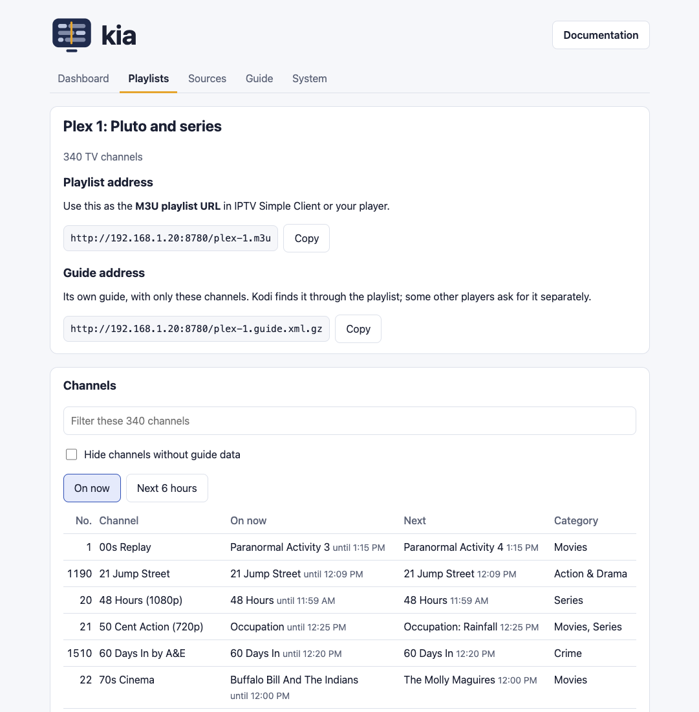

# Playlists for people and devices

kia's main playlist, `curated.m3u`, has every working channel. That's often more than one person or one TV needs: the kids' tablet doesn't need the news, and the living room TV doesn't need shopping channels. Profiles let you make smaller playlists from the full one, each with its own address.

Each profile also gets its own program guide with only its channels, so a slow device has much less to load. A channel keeps the number it has in the full list, so it's number 45 everywhere, unless you choose to number a profile from 1.

You can make profiles on kia's status page or by editing a file. Both change the same file, `profiles/profiles.toml`, so you can switch between them.

## On the status page

1. Find kia's password. kia made one when it first started; in the kia folder, run:

   ```sh
   cat state/admin-password.txt
   ```

   You can change it later on the status page. [The secure status page](secure-page.md#the-password) has more about the password.

2. Open the secure status page at `https://<your address>:8743/` and choose **Make a playlist**. (The plain `http://` page has a link to it.) The first time, your browser warns that the certificate isn't trusted, because kia made it itself; [here's how to continue](secure-page.md#the-browser-warning).

3. Fill in the form:
   - **Short name**: becomes the playlist's address, so `kids` is `http://<your address>:8780/kids.m3u`.
   - **Start with**: every channel, or only the categories, source playlists, and channel names you tick.
   - **Leave out**: categories or names you don't want, and TV or radio as a whole.
   - **Channel numbers**: tick it to number this playlist 1, 2, 3 instead of using the full list's numbers.
   - **Always include**: search for specific channels to add whatever the other settings say.

   As you change things, the form shows how many channels the playlist would have.

4. Enter the password and choose **Save**. kia makes the playlist right away and opens its page, which lists its channels and its address with a Copy button.

5. On the device, use that address as the **M3U playlist URL** in IPTV Simple Client (or your player), instead of `curated.m3u`. Kodi finds the playlist's own guide by itself. If another player asks for a guide address, it's on the same page.



To change or delete a playlist later, open it from the secure status page and choose **Edit this playlist**. The browser tab remembers the password until you close it.

## In the file

If you'd rather use a text editor, copy the example into place:

```sh
cp profiles/example.toml profiles/profiles.toml
```

git ignores your copy, so updating kia never changes it. It starts with three profiles you can keep, change, or delete:

```toml
[kids]
title = "Kids"
groups = ["Kids", "Animation", "Family"]
radio = false

[living-room]
title = "Living room"
exclude_groups = ["Shop", "Religious"]

[radio]
title = "Radio only"
tv = false
```

The name in square brackets becomes the playlist's address. Use lowercase letters, numbers, and dashes. Changes in the file show up after the next nightly run. To see them sooner, run the stream check now, which tests every stream again and takes up to an hour:

```sh
docker compose exec kia python3 -m kia check
```

Changes made on the status page show up right away.

When the status page saves, it rewrites the file and drops any comments you added, so keep notes somewhere else.

## What a profile can say

| Setting | What it does | Example |
|---|---|---|
| `title` | The name shown on the status page | `"The kids"` |
| `groups` | Include channels in these categories | `["Kids", "Animation"]` |
| `sources` | Include channels from these playlists, by the names in your sources list | `["samsung-us"]` |
| `names` | Include channels whose names contain these words | `["news", "weather"]` |
| `channels` | Include these channels by ID, whatever else the profile says | `["CNN.us@SD"]` |
| `exclude_groups` | Leave out these categories | `["Shop"]` |
| `exclude_names` | Leave out channels whose names contain these words | `["kids"]` |
| `exclude_channels` | Leave out these channels by ID, whatever else the profile says | `["CNN.us@SD"]` |
| `tv`, `radio` | Include TV channels, radio stations (both are included unless you say `false`) | `radio = false` |
| `renumber` | Number this playlist's channels from 1 | `renumber = true` |

If a profile names something to include (`groups`, `sources`, or `names`), it starts with just those channels; otherwise it starts with all of them. Anything in `exclude_groups` or `exclude_names` is then taken out. `channels` adds specific channels, even ones the other rules left out, and `exclude_channels` takes specific channels out, even ones `channels` names.

Categories are the ones in the full playlist, such as "News", "Kids", or "Sports". Each playlist's page on the status page shows every channel's category and number. Upper and lower case don't matter. `names` and `exclude_names` are patterns, so `"news"` also matches "Fox News Now" and "NewsNation"; to match a whole name exactly, write `"^CNN$"`.

## More examples

Just your favorites (the channels you've starred on the status page; see [favorites](configuration.md#favorites-and-your-own-channel-numbers)):

```toml
[favorites]
groups = ["Favorites"]
renumber = true
```

A news and weather playlist for the kitchen:

```toml
[kitchen]
names = ["news", "weather"]
radio = false
```

Everything from the Samsung TV Plus list except shopping:

```toml
[samsung]
sources = ["samsung-us"]
exclude_groups = ["Shop"]
```

A short list picked by ID and numbered 1 to 2:

```toml
[picks]
channels = ["CNN.us@SD", "PBSKids.us@SD"]
renumber = true
```

## If something goes wrong

If the status page has no **Make a playlist** button, you're on the plain `http://` page (use its link to the secure page), or editing is turned off with `KIA_EDITING=false` in `.env`.

If the profiles file has a mistake, such as a missing bracket or a misspelled setting, kia keeps the profile playlists it made last time and shows the problem on the status page. The full playlist updates as usual, and the page won't save changes over a file it can't read. Fix the file, and the next run picks it up. Each time the status page saves, it keeps the previous file as `profiles/profiles.toml.bak`.

When you delete a profile, kia removes its playlist, guide, and page from the server.

## The TV-only playlist

When your list has radio stations, kia also makes **TV only** (`tv.m3u`, with its own guide `tv.guide.xml.gz`), for players such as Jellyfin that show radio stations as TV channels. It works like a profile with `radio = false`, but there's nothing to set up or edit. To change it, make a profile of your own named `tv`; yours replaces kia's.
