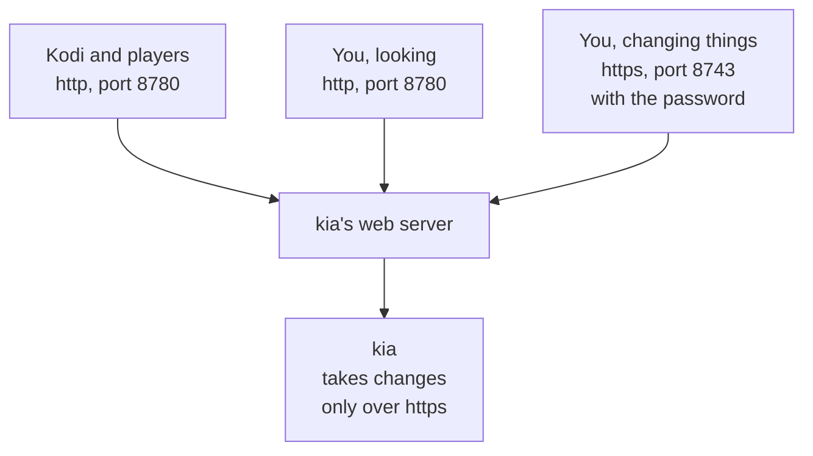

# The secure Dashboard and your password

kia's Dashboard is on two ports:

| Address | What it's for |
|---|---|
| `http://<your address>:8780/` | Playlists and guides for Kodi and other players, and the Dashboard to look at |
| `https://<your address>:8743/` | The same Dashboard, where you add and change playlists, choose the playlists kia checks, and change the password |

Changes are accepted only on the secure (`https://`) page, so the password never crosses your network in the clear. Playlists and guides stay on plain HTTP because Kodi and most players refuse a certificate they don't trust, and kia's own certificate is one of those.



## The browser warning

The first time you open the secure page, your browser says the connection isn't private or the certificate isn't trusted. That's because kia made the certificate itself (it's "self-signed"), instead of getting it from a company your browser knows. The connection is still encrypted.

To continue, choose **Advanced**, then **Proceed** (Chrome and Edge), **Accept the Risk and Continue** (Firefox), or **Show Details** and **visit this website** (Safari). Most browsers remember this for a while. To get rid of the warning for good, use [your own certificate](#using-your-own-certificate).

## The password

When kia first starts, it makes a password like `kxq7-m2pa-9fht`. To see it, look in the kia folder:

```sh
cat state/admin-password.txt
```

The Dashboard asks for it when you save a change, and the browser tab remembers it until you close it.

### Changing it

Open the secure page, go to **System**, and use **Change password**. kia then deletes `state/admin-password.txt` and keeps only a scrambled form of the password.

### If you forget it

Make a new one, then read it from the file kia saves it in:

```sh
docker compose exec kia python3 -m kia password --reset
cat state/admin-password.txt
```

### Setting it in `.env`

Add `KIA_ADMIN_PASSWORD=...` to `.env` and restart kia (`docker compose up -d`). A password in `.env` always wins, and can only be changed there.

### Turning editing off

Set `KIA_EDITING=false` in `.env` and restart kia. The Dashboard then only shows your playlists.

## Names on the certificate

kia's certificate covers the address in `KIA_PUBLIC_URL`. If you reach kia by another name, such as one from your own DNS, list the names and addresses in `.env`:

```sh
KIA_TLS_NAMES=kia.home.lan,192.168.1.20
```

The Dashboard's "secure page" links use the first one. kia makes a new certificate when this list changes, and renews its own a month before it expires.

## Using your own certificate

A certificate from a known authority removes the browser warning. Put it in kia's `tls` folder as two files, `fullchain.pem` (the certificate) and `privkey.pem` (its key), then make them readable by the web server:

```sh
chmod 644 tls/fullchain.pem tls/privkey.pem
```

The web server picks up the new files within a minute. kia never replaces a certificate it didn't make, so renewing yours is up to you; the Dashboard warns three weeks before it expires. To check what's installed:

```sh
docker compose exec kia python3 -m kia tls
```

To go back to kia's own certificate, run `docker compose exec kia python3 -m kia tls --self-signed`.

### With Tailscale

If you use [Tailscale](https://tailscale.com) to reach kia away from home, it can give the machine a trusted certificate for its `.ts.net` name.

1. In the Tailscale admin console, open **DNS**, make sure MagicDNS is on, and under **HTTPS Certificates** choose **Enable HTTPS**. The machine's name becomes public in certificate logs, so rename it first if the name says something you'd rather keep private.
2. On the kia machine, in the kia folder (use your machine's full name, shown in the admin console):

   ```sh
   sudo tailscale cert --cert-file tls/fullchain.pem --key-file tls/privkey.pem my-server.tail1234.ts.net
   sudo chown "$(id -u):$(id -g)" tls/*.pem && chmod 644 tls/*.pem
   ```

3. Add the name to `.env` so the Dashboard links to it, then restart kia:

   ```sh
   KIA_TLS_NAMES=my-server.tail1234.ts.net
   ```

These certificates last 90 days. Run step 2 again each month, for example from cron.

### With Let's Encrypt

Let's Encrypt gives free certificates for a domain you own. Use its DNS check, which proves you own the domain through your DNS provider. Its other check needs a port open to the internet, and kia should never be reachable from the internet.

With [certbot](https://certbot.eff.org) and its plugin for your DNS provider (Cloudflare here; there are plugins for most providers):

```sh
sudo certbot certonly --dns-cloudflare --dns-cloudflare-credentials ~/.secrets/cloudflare.ini -d kia.example.com
sudo install -m 644 /etc/letsencrypt/live/kia.example.com/fullchain.pem /etc/letsencrypt/live/kia.example.com/privkey.pem tls/
```

Then set `KIA_TLS_NAMES=kia.example.com` in `.env` and restart kia. The name also has to lead to the kia machine on your network: add it to your router's or home DNS server's local records. certbot renews by itself; to copy the renewed files each time, give it a deploy hook that runs the `install` line above (`--deploy-hook`).

## Without Docker

`kia serve` and `kia daemon --serve` serve both ports themselves, with the same `tls` folder, password, and settings. They need the `openssl` command to make kia's own certificate; macOS and most Linux systems have it. `--https-port 0` turns the secure page off.
