# Setups

The setups below differ only in who can reach kia and how much work the machine does. Each recipe lists the `.env` lines to change from `.env.example`.

They're about where kia runs and who can reach it. To run Plex, Jellyfin, or graphs on the same computer too, see [choosing the parts of kia's stack](stack.md), or follow one of the [cookbooks](cookbooks/README.md).

<picture>
  <source media="(prefers-color-scheme: dark)" srcset="../images/diagrams/setups-dark.svg">
  
</picture>

## Home server

One always-on machine (a Linux box, NAS, or mini PC) serves every TV, phone, and computer in the house, including ones that can't run anything themselves, like Fire TV, Android TV, or Apple TV.

```ini
# This machine's address on your network
KIA_PUBLIC_URL=http://192.168.1.20:8780
# Reachable by other devices
KIA_BIND=0.0.0.0
```

Give the machine a fixed address (a DHCP reservation in your router) so the address in your players keeps working. The [TV in every room](cookbooks/every-room.md) cookbook walks through it, with a playlist for each room or person.

## Same machine as Kodi

A desktop, laptop, or Linux box that both runs kia and plays TV. Nothing is exposed to the network.

```ini
KIA_PUBLIC_URL=http://localhost:8780
KIA_BIND=127.0.0.1
```

The nightly run uses a fair amount of CPU, network, and memory for up to an hour, so keep `KIA_RUN_AT` at a time you're not watching. A run missed while the computer was asleep happens within a minute of waking, and one missed while it was off happens when kia starts. The [laptop or desktop cookbook](cookbooks/kodi-computer.md) walks through this setup from the start.

## Laptop that travels (with a home server)

The laptop tests streams itself, because what plays depends on where you are. It copies the guide from your home server when it can reach it, which saves the long guide download. Away from home, it builds its own guide (or keeps the last copy; see below).

```ini
KIA_PUBLIC_URL=http://localhost:8780
KIA_BIND=127.0.0.1
# Your home server
KIA_UPSTREAM_URL=http://192.168.1.20:8780
# Away from home: reuse the last guide (or "grab" a fresh one)
KIA_UPSTREAM_FALLBACK=cached
```

Use the same playlist list as the home server, so its guide covers the same channels. Kodi on the laptop points at `http://localhost:8780/curated.m3u`. The [traveling laptop cookbook](cookbooks/travel-laptop.md) walks through it, with the choice between `cached` and `grab`.

## Raspberry Pi

A Pi 4 or 5 (64-bit OS, 4 GB or more) can be a home server. It can also run kia alongside Kodi: LibreELEC offers a Docker add-on, though kia hasn't been tested there yet. Use any recipe above, plus:

```ini
KIA_PARALLEL_SITES=1
KIA_CHECK_CONCURRENCY=8
KIA_MEMORY_LIMIT=2g
```

Runs take longer. With one site at a time, memory use peaks around 0.7 GB. Use a good SD card or, better, a USB SSD.

## Without Docker

You can run kia directly, as a service that starts with the computer. You need Python 3.11 or newer (kia needs nothing else from Python), ffmpeg, git, openssl, and Node.js 22 or newer for guide downloads from websites. On macOS: `brew install python ffmpeg git openssl node`. On Ubuntu or Debian: `sudo apt install python3 ffmpeg git openssl`, plus Node.js from [nodejs.org](https://nodejs.org/).

In the kia folder, run:

```sh
scripts/install-service.sh
```

On Linux it installs a systemd user service (`deploy/kia.service`); on macOS, a launchd agent (`deploy/kia.plist`). It makes `.env` with this computer's address and time zone if there isn't one, starts kia, and prints the Dashboard's address and the password. Settings work as with Docker: `.env` and `kia.toml`. kia serves the playlists, the Dashboard, and the secure page itself, and plays [Pluto TV channels](how-it-works.md#pluto-tv) itself too.

- After changing `.env`, run the script again (on macOS it copies the settings into the agent).
- To update: `scripts/update.sh --no-docker`, which moves kia to its newest release and runs the script again.
- On Linux, a user service runs only while you're logged in, unless you run `sudo loginctl enable-linger $USER` once; the script reminds you.
- The log: `journalctl --user -u kia -f` on Linux, `work/logs/kia.log` on macOS.
- On Linux, the service may change only kia's own folders (`output/`, `state/`, `work/`, `vendor/`, `profiles/`, `tls/`) and npm's cache. If you moved one of them in `kia.toml`, run `systemctl --user edit kia` and add `ReadWritePaths=/that/folder` under `[Service]`. On Ubuntu 23.10 and newer this file limit doesn't work for a service you run as yourself (`install-service.sh` says so), and kia can write anywhere you can; Docker locks it down fully. [Security](../SECURITY.md#the-containers) has the details.
- `scripts/install-service.sh --uninstall` removes the service and keeps your settings and data.

To run kia in a terminal instead, for a quick try: `PYTHONPATH=src KIA_EPG_RUNNER=local python3 -m kia daemon --serve --run-now`. It refreshes daily at `KIA_RUN_AT` (04:00), refreshes the guide every 4 hours, and stops when you close the terminal. Run this way, none of the limits apply: neither Docker's memory limit and lockdown nor the service's.
