# Your stack from the Dashboard, start to finish

This guide takes you from nothing installed to Plex, Jellyfin, or graphs running next to kia, chosen on kia's Dashboard instead of in a terminal. It covers the first time, start to finish, including the few things only you can do, such as linking Plex to your account.

kia runs in a locked-down container with no access to Docker, so the Dashboard can't start or stop programs by itself. A small helper on the computer, the **kia-stack service**, does that part for it. You install it once (step 1), and from then on the Dashboard's **Stack** page asks it to check and apply your choice.

<picture>
  <source media="(prefers-color-scheme: dark)" srcset="../images/diagrams/stack-service-dark.svg">
  
</picture>

How it all works inside, file by file: [the stack under the hood](stack-under-the-hood.md). The same steps in a terminal: [choosing the parts of kia's stack](stack.md).

## What you need

- A Mac or a Linux computer with Docker, as for [installing kia](install.md). Plex and Jellyfin each want about 2 GB of memory more, and the graphs about half a GB more.
- For Plex, a free Plex account.
- About 30 minutes, plus up to an hour for kia's first refresh, which you don't need to watch.

## 1. Install kia, with the kia-stack service

In the Terminal:

```sh
curl -fsSL https://raw.githubusercontent.com/southsidedean/kodi-iptv-assistant/main/scripts/install.sh | sh
```

- When it asks what this kia is for, choose `kodi` (the default) for now. You'll choose the rest on the Dashboard.
- When it asks whether to install the kia-stack service, say yes (the default).
- At the end it prints two things to keep: the Dashboard's address, such as `http://192.168.1.20:8780/`, and the **password for making changes**.

Already have kia? In the kia folder, run `scripts/install-service.sh --stack` instead.

On Linux, run one more command. The service is a systemd user service, which runs only while you're logged in unless you allow it to keep running. The installer prints this command when it's needed; run it once:

```sh
sudo loginctl enable-linger "$(id -un)"
```

On a Mac, the service starts when you log in, like other apps.

Then wait for kia's first refresh. The Dashboard says when it's done.

## 2. Open the Stack page

Changes happen on the secure Dashboard, at `https://` and port 8743: `https://192.168.1.20:8743/`, with your address.

- The first time, your browser warns about the certificate, because kia made its own. That's expected on your home network: choose the browser's *Advanced* or *Show details*, then continue to the address. [Why, and how to stop the warning](secure-page.md#the-browser-warning).
- The password is the one the installer printed. Lost it? It's in `state/admin-password.txt` in the kia folder ([the password](secure-page.md#the-password)).

Choose **Stack** in the menu at the top, and enter the password in the **Password** box.


**What runs now** lists every program next to kia and its state. A line in red means it isn't running, or Docker says it's unhealthy. Without the kia-stack service, this section says so, and the bottom of the page shows the command to run in the kia folder instead.

## 3. Only for some setups: a setting first

The Stack page takes care of most first-time setup. It makes Plex's playlist, asks for Plex's claim code, and fills in the addresses Plex and Jellyfin apps use. Three setups need something from you first:

- **Threadfin for a Plex you already run** (the *Threadfin for your Plex* card): so kia can add its channels to your Plex by itself, set `KIA_PLEX_URL` and `KIA_PLEX_TOKEN` ([how](plex.md#let-kia-add-them)). Without them, you add the tuner in Plex's settings yourself ([Plex](plex.md#in-plexs-settings)).
- **Graphs on a Mac:** the Mac's own numbers (processor, memory, disks) need Homebrew's node-exporter: `brew install node_exporter`, then `brew services start node_exporter` ([why](cookbooks/observability.md#on-a-mac)).
- **Graphs, your own Grafana password** (optional): set `KIA_GRAFANA_PASSWORD`. Otherwise Grafana gets a random one.

These go in `.env`, the settings file in the kia folder. Open it with `open -e .env` on a Mac or `nano .env` on Linux. Each line is already in the file, empty; fill in that line instead of adding another, because Docker uses the last copy of a line.

## 4. Choose, and check

Choose a card: it ticks the parts for that setup. For a combination no card has, open **Choose the parts yourself** and tick them one by one ([what each part is](stack.md#the-parts)). The box below shows the same choice as a command for the kia folder, if you'd rather run it there.

Choose **Check**. Within a few seconds, the kia-stack service checks the choice for this computer, and the page shows what it found:


- **No problems** turns **Apply** on.
- **Check found problems** keeps **Apply** off. Each problem says what to change, such as a port another program uses, or a part that doesn't work on a Mac. Fix it, then choose **Check** again. [If something's wrong](#if-somethings-wrong) lists the common ones.
- **Warnings** don't stop you, but read them.
- **Stops what runs now** lists parts that run now and that this choice leaves out. **Apply** stops them.

**Plex's playlist.** Plex gets its channels from kia's playlist named `plex`, through Threadfin. The first time, the check says there's no such playlist yet, and the page offers to make it:

- With 480 TV channels or fewer (Plex's limit for one tuner), choose **Make the plex playlist**, then **Check** again.
- With more, the page sends you to **Playlists**. Choose **Make a playlist**, name it `plex`, tick the categories you watch until it's 480 channels or fewer, and tick **For Plex through Threadfin**. Then come back and choose **Check** again. ([More on the playlist for Plex](cookbooks/plex-box.md#2-make-the-playlist-for-plex).)

## 5. Apply

**Plex's claim code.** The first time Plex starts, it needs a claim code, which links the new Plex to your Plex account. With Plex chosen and not running yet, the page shows a **Plex claim code** box. Right before you apply, sign in at [plex.tv/claim](https://plex.tv/claim), copy the code (it starts with `claim-`), and paste it in. It works for only 4 minutes, so apply straight after.

Choose **Apply**. If someone is watching through kia, Plex, or Jellyfin, or the choice stops something, the page asks first.

Then the service starts and stops what changed. That can take a few minutes the first time, while Docker downloads Plex, Jellyfin, or Grafana. When the choice changes what runs, kia itself restarts too: the page says so and keeps asking until it's back. When it's done, it says **Done**, **What runs now** shows the new programs, and **What's next** says what each new part still needs:


## 6. Finish each part

Most parts need one last thing, the first time only. **What's next** on the page links to each.

**Jellyfin.** Finish its setup right away: until you do, anyone on your network who opens its page can make themselves its administrator. Open `http://192.168.1.20:8096` (your address), then add kia's channels as live TV. The Jellyfin cookbook walks through both: [set up Jellyfin](cookbooks/jellyfin-box.md#3-set-up-jellyfin) and [add kia's channels](cookbooks/jellyfin-box.md#4-add-kias-channels). Optionally, give kia an API key, so the Jellyfin dashboard in Grafana can see what's playing ([how](cookbooks/jellyfin-box.md#6-see-whats-playing-optional)).

**Plex.** kia adds its channels to Plex as Live TV by itself after its next guide refresh, within 4 hours. To do it now, choose **Add Live TV to Plex now**. The first time can take a few minutes, while Plex downloads what it needs to play TV. Then open Plex at `http://192.168.1.20:32400/web`: **Live TV** has your channels. Plex uses the claim code only once, so you can empty `PLEX_CLAIM=` in `.env` now.

**Threadfin for your own Plex.** With `KIA_PLEX_URL` set (step 3), kia adds the tuner to your Plex the same way, and the same button does it now. Otherwise, add it in Plex's settings ([Plex](plex.md#in-plexs-settings)).

**Graphs.** Open Grafana at `https://192.168.1.20:8788` and sign in as `admin`. The password is the one you chose, or the one in `monitoring/grafana/admin-password.txt` in the kia folder ([open Grafana](cookbooks/observability.md#3-open-grafana)). The Dashboard also gets an **Observability** button.

To change what runs later, come back to the Stack page: choose, **Check**, **Apply**.

## If something's wrong

**Check is greyed out, and the page says the kia-stack service isn't running.** The page hasn't heard from the service for 90 seconds.

- On Linux, `systemctl --user status kia-stack` shows whether it runs, and `journalctl --user -u kia-stack -f` shows what it says. If it stopped when you logged out, run the `loginctl enable-linger` command from step 1.
- On a Mac, `launchctl list | grep kia-stack` shows it, and its log is `work/logs/kia-stack.log` in the kia folder.
- To install it again: `scripts/install-service.sh --stack`.

**"The kia-stack service hasn't picked the request up."** The service isn't running: start it as above. The page keeps waiting for 5 minutes, and the service refuses a request older than that, so choose **Check** again once it runs.

**"The kia-stack service refused it."** The request wasn't one it accepts: only check or apply, with the parts listed on the page and, for Plex, a claim code from plex.tv/claim. Reload the page and try again.

**Check found a problem.** Each problem names its setting or step. The common ones:

| Problem | What to do |
|---|---|
| there's no playlist named plex for Threadfin yet | Make it (step 4), then choose **Check** again |
| port 32400 (or another) is in use | Another program has it. Stop that program, or set the setting the problem names to another port in `.env` |
| observability-gpu and observability-disks are for Linux | Untick them on a Mac |
| plex already brings its tuner | Untick `plex-tuner`: it's for a Plex on another computer |

**A warning says this computer has N GB of memory.** It may still run. Fewer parts at once, or more memory, is safer ([setups](setups.md)).

**Apply didn't finish.** The page shows what the script said. In the kia folder, `docker compose ps` shows what runs, and `scripts/stack.sh` shows the choice and what each part is doing. Your `.env` from before the apply is in `state/env.before-stack-<date>`.

**Plex isn't on your account.** The claim code had run out, or Plex started without one. Get a new code at [plex.tv/claim](https://plex.tv/claim), put it in `.env` as `PLEX_CLAIM=claim-...`, and in the kia folder run `docker compose up -d --force-recreate plex` within 4 minutes.

**No answer after five minutes.** The service may still be downloading a large program. Check its log (above). When it finishes, reload the Stack page: it shows the answer.
