# Troubleshooting

Start with kia's [Dashboard](how-it-works.md#the-dashboard) at `http://<your address>:8780/`. It shows whether the last refresh worked, when the next one is, the channel counts, and the alerts from the last run. Most of the problems below show up there first.

The commands on this page run in a terminal, in the kia folder, on the computer that runs kia.

**Ask kia first.** On the Dashboard, **Ask kia what's wrong** reads what kia wrote down about the last refresh and says what's wrong, which file shows it, and what to do. On a playlist's page, **Why?** next to a channel does the same for that channel: whether its stream works, and why its guide is full, partial, or only its name. Neither changes anything. In a terminal, `kia doctor` gives the same answers. With Docker:

```sh
docker compose exec kia python3 -m kia doctor
docker compose exec kia python3 -m kia doctor channel "CNN"
```

Without Docker, run `PYTHONPATH=src python3 -m kia doctor` in the kia folder.

Not sure where to look? Start at the top:

<picture>
  <source media="(prefers-color-scheme: dark)" srcset="../images/diagrams/troubleshooting-dark.svg">
  
</picture>

[kia won't start](#kia-wont-start) · [other devices can't connect](#other-devices-cant-connect) · [the refresh failed](#the-dashboard-says-the-refresh-failed) · [no channels](#no-channels) · [the guide is empty](#channels-but-the-guide-is-empty) · [a channel won't play](#a-channel-wont-play)

## In Kodi

### No channels

Open `http://<your address>:8780/curated.m3u` in a browser on the same network as the Kodi device.

- If it doesn't download, Kodi can't reach kia either. See [other devices can't connect](#other-devices-cant-connect).
- If it downloads, check the add-on's **M3U playlist URL** in Kodi ([Kodi setup](kodi.md#3-point-it-at-the-playlist)), then restart Kodi.
- If the Dashboard says *Waiting for the first refresh*, kia's first run is still going. It can take up to an hour.

### Channels, but the guide is empty

Give it a couple of minutes, then restart Kodi. If it's still empty, open the playlist URL in a browser. Its first line shows the guide address (`x-tvg-url`) that Kodi uses. That address comes from `KIA_PUBLIC_URL` in `.env`, so it must be one this Kodi device can reach. If it's wrong, fix `KIA_PUBLIC_URL`, run `docker compose up -d`, then [refresh now](configuration.md#when-changes-take-effect).

Some channels have no guide data anywhere. They show their own name in the guide instead of programs. **Why?** next to a channel on its playlist's page says whether it matched a guide source and which one it uses, or why it has none. `guide-report.html`, linked from the Dashboard's **Guide** page, shows the same for every channel.

### A channel shows another channel's programs

Most likely kia matched it to a guide by name, and the name belongs to a different channel. `mapping-report.html` lists every channel matched by name, with the name the guide site uses. Add the channel's guide ID (`tvg-id` in the report, such as `CNN.us`) to `ignore_name_matches` under `[epg]` in `kia.toml`, for example `ignore_name_matches = ["News12.us@SD"]`. From the next run, the channel uses another guide source or shows its own name.

### A channel won't play

Free streams come and go. The nightly check drops a stream once it has failed a few nights in a row, so a stream that has just broken can stay in the list for a couple of days. `report.html` shows each stream's last result.

To check one now, open the playlist's page on the secure Dashboard, enter the password, and choose **Test** on the channel's row. kia tries the stream right away, as the nightly check does:

- If it plays from kia, the problem is more likely the device or the app. Try the channel in another player, such as VLC.
- If it doesn't play, choose **Take it out until it works**. kia removes it from every playlist now, and the nightly check puts it back after its stream works three nights in a row. Removed channels are listed on the Everything page, each with **Put back**.

### Pluto TV channels freeze or jump at ad breaks

Pluto TV's streams break most players at ad breaks: the picture goes black or freezes, or the show jumps back a few minutes. kia fixes this by playing Pluto channels itself and handing your players a steady stream ([how](how-it-works.md#pluto-tv)). It's on unless `KIA_PLUTO_RELAY=false` is in `.env`.

If a Pluto channel still misbehaves:

- Open the playlist URL in a browser and look for the channel. Its address should be `http://<your address>:8780/pluto/<id>.m3u8`. If it still starts with `https://jmp2.uk/`, the relay is off, or the playlist was made before you turned it on; it changes at the next refresh.
- Look at **Pluto TV** on the Dashboard's **System** page while the channel plays. It shows each channel playing through kia and any recent problems, such as Pluto's servers not answering.
- If the home page says Pluto channels are playing without kia's fix, kia couldn't open a Pluto session of its own, so it's using Pluto's plain link for now. kia tries again every five minutes. Turn on the `pluto_fallback` [alert](alerts.md) to hear about it.

### Sound is choppy on some channels

Most streams, Pluto TV's included, have 48 kHz sound. If the device's sound output is set to another rate, such as 44.1 kHz, Kodi converts it as it plays, and on some devices that comes out choppy. Set the output to 48 kHz: in Kodi, *Settings → System → Audio*, set **Output configuration** to *Fixed* and **Limit sampling rate** to *48.0 kHz* (at the *Advanced* settings level).

Kodi can also leave a sound output at another rate after it quits, so the computer's own sound on a TV turns choppy. On a Mac, open **Audio MIDI Setup** (Applications → Utilities), choose the TV or speaker on the left, and set **Format** to 48,000 Hz. The fixed Kodi setting above keeps it from happening again.

### Changes don't show up

kia applies changes to your playlists and settings at its next run, and Kodi picks them up within two hours (its refresh interval) or when it restarts. To do both now, see [when changes take effect](configuration.md#when-changes-take-effect).

### Old, missing, or mixed-up channels

This can happen after changing playlists. Clear Kodi's TV data: *Settings → PVR & Live TV → General → Clear data → All → OK*. Kodi reloads everything from kia within a minute or so.


### Channel numbers keep changing

Turn on **Use channel numbers from backend** in Kodi ([Kodi setup, step 5](kodi.md#5-keep-channel-numbers-steady-optional)). Without it, Kodi numbers channels by their place in the list.

### The list doesn't update unless Kodi restarts

Set IPTV Simple Client's **Auto refresh mode** to *Repeated refresh* and **Refresh interval** to 120 ([Kodi setup, step 3](kodi.md#3-point-it-at-the-playlist)).

## On the Dashboard

### The browser warns the connection isn't private

That's the secure page (`https://…:8743`) and kia's own certificate. The connection is encrypted; your browser just doesn't know kia. [The browser warning](secure-page.md#the-browser-warning) shows how to continue, and how to use a certificate your browser trusts.

### There's no Make a playlist or Edit button

Those are on the secure page. On the plain `http://` page, use the link to it. If neither page has them, editing is turned off with `KIA_EDITING=false` in `.env`.

### It says the password is wrong, or I've forgotten it

If you haven't changed it, it's in `state/admin-password.txt` in the kia folder. If `KIA_ADMIN_PASSWORD` is set in `.env`, that's the password. Otherwise make a new one, then read it:

```sh
docker compose exec kia python3 -m kia password --reset
cat state/admin-password.txt
```

### Changes are refused "only on the secure page"

The page you're on is the plain `http://` one. Open the `https://…:8743` address instead; the plain page links to it.

## In other players

Each [player's guide](players.md) ends with its own common problems. If a channel won't play in any app, it's the stream itself; see [a channel won't play](#a-channel-wont-play).

## On the computer running kia

### kia won't start

If `docker compose up -d` stops with an error, or `docker compose ps` doesn't list `kia` and `web`:

- `Cannot connect to the Docker daemon`: Docker isn't running. On macOS, start Docker Desktop and wait for the whale icon to stop moving; on Linux, run `sudo systemctl start docker`.
- `port is already allocated` or `address already in use`: another program uses port 8780 or 8743. Pick other ports with `KIA_PORT` and `KIA_HTTPS_PORT` in `.env` (and use the new port in `KIA_PUBLIC_URL`), then run `docker compose up -d` again.
- `no space left on device`: the disk is full. `docker system df` shows what Docker uses.
- An error during the build: run `docker compose build --pull kia` again; a download may have failed. If it keeps failing, open an issue with the end of the output.
- `kia` keeps restarting: `docker compose logs --tail 50 kia` shows why. A mistake in `.env` or `kia.toml` is the usual cause, and the message names the setting.

### Changing kia's address

If the kia computer gets a new address (after a router change, say) or you move kia to another computer:

1. Set `KIA_PUBLIC_URL` in `.env` to the new address, and update `KIA_TLS_NAMES` if you set it.
2. Run `docker compose up -d`. kia makes a new certificate for the secure page by itself, and writes the new address into the playlists at its next refresh ([refresh now](configuration.md#when-changes-take-effect) to do it sooner).
3. On each device, change the playlist address in the player (in Kodi, IPTV Simple Client's **M3U playlist URL**) and restart it.

A DHCP reservation in your router keeps the address from changing again.

### Other devices can't connect

- Check that `KIA_BIND` in `.env` is `0.0.0.0`, then run `docker compose up -d`.
- A firewall: with Docker, ufw on the kia computer neither opens nor closes kia's ports (Docker lets connections past it by itself), so look at the router's or the device's. Without Docker, ufw does apply: `sudo ufw allow 8780/tcp` and, for the secure Dashboard, `sudo ufw allow 8743/tcp`.
- Check that kia is running: `docker compose ps` should list `kia` and `web` as running and `(healthy)`. If one isn't running, run `docker compose up -d`. If one says `(unhealthy)`, it's running but not answering: `docker compose logs --tail 50 kia` (or `web`) usually says why, and `docker compose restart kia` often fixes it.
- If the computer's address changed (after a restart, for example), update `KIA_PUBLIC_URL` and the playlist URL in Kodi. A DHCP reservation in your router keeps the address fixed.

### The Dashboard says the refresh failed

The log says why. To see the end of it:

```sh
docker compose logs --tail 100 kia
```

Common causes:

- Many guide sites `FAILED`, or the log stops suddenly while downloading guides: kia probably ran out of memory. Lower `KIA_PARALLEL_SITES` (each guide site uses up to about 0.7 GB), or raise `KIA_MEMORY_LIMIT` if the computer has memory to spare.
- `Permission denied`: see [file permission errors](#file-permission-errors).
- `Read-only file system`: a folder setting in `kia.toml` was changed. With Docker, kia can only write to `output/`, `state/`, `work/`, `vendor/`, `profiles/`, `tls/`, and `plex/warmup/`, so keep those settings as they are ([why](configuration.md#versions)).
- An error about `.env` or `kia.toml`: the message names the setting. Fix it, run `docker compose up -d`, and [refresh now](configuration.md#when-changes-take-effect).

### File permission errors

kia writes its files as the user in `PUID` and `PGID`. If those don't match your user, or another user created the folders, give the folders back to yourself:

```sh
sudo chown -R "$(id -u):$(id -g)" output state work vendor profiles tls plex/warmup
```

Then set `PUID` and `PGID` in `.env` to the numbers that `id -u` and `id -g` print, and run `docker compose up -d`.

### The nightly run takes too long

A run usually takes 15 minutes to an hour, depending on how many playlists you've turned on and how many guide sites they need. To speed it up, turn off playlists you don't watch, raise `KIA_CHECK_CONCURRENCY` (streams tested at once) if your connection can take it, or exclude slow guide sites with `KIA_EXCLUDE_SITES`. A guide site that runs past `site_time_limit` in `kia.toml` (30 minutes) is stopped, and its channels keep their previous guide. `mapping-report.html` shows how many channels each site covers.

## Alerts

[Alerts](alerts.md) explains each one. What to do about them:

- `dns_local`: this computer's DNS can't find names that public DNS can, so Kodi may have the same trouble. Check your router or ad-blocker. To test a name from inside kia: `docker compose exec kia getent hosts <name>`. kia doesn't raise this alert when only a site's IPv6 lookup fails while the IPv4 one works; that's usually the site's own DNS, and the log says so.
- `run_failed`: see [the refresh failed](#the-dashboard-says-the-refresh-failed).
- `channels_drop`: open `report.html`. If one playlist accounts for most of the drop, it probably broke upstream; it often comes back within days. If streams from every playlist failed, the internet connection probably had trouble during the run.
- `guide_drop`: open `guide-report.html` to see which site lost channels. A site that stays broken can be skipped with `KIA_EXCLUDE_SITES`.
- `pluto_fallback`: kia couldn't open a Pluto session of its own for a while, so Pluto channels are playing without kia's fix and may freeze at ad breaks. kia tries again every five minutes and goes back to its own session when Pluto lets it. The Pluto TV section on the Dashboard's **System** page shows the errors.
- `site_failing`: the alert names the site and its log file under `work/logs/`. If the site stays broken, add it to `KIA_EXCLUDE_SITES`; its channels use other sites where they can.

## Still stuck?

Open an issue on [GitHub](https://github.com/southsidedean/kodi-iptv-assistant/issues) with what you see, the end of `docker compose logs kia`, and what `docker compose exec kia python3 -m kia settings` prints (it shows only whether each password is set). Please don't post your `.env`: it holds your passwords and tokens.
