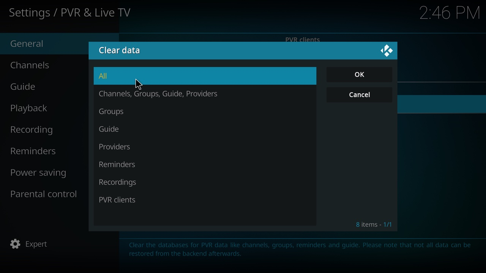

# Troubleshooting

Start with kia's [status page](how-it-works.md#the-status-page) at `http://<your address>:8780/`. It shows whether the last refresh worked, when the next one is, the channel counts, and the alerts from the last run. Most of the problems below show up there first.

The commands on this page run in a terminal, in the kia folder, on the computer that runs kia.

## In Kodi

### No channels

Open `http://<your address>:8780/curated.m3u` in a browser on the same network as the Kodi device.

- If it doesn't download, Kodi can't reach kia either. See [other devices can't connect](#other-devices-cant-connect).
- If it downloads, check the add-on's **M3U playlist URL** in Kodi ([Kodi setup](kodi.md#3-point-it-at-the-playlist)), then restart Kodi.
- If the status page says *Waiting for the first refresh*, kia's first run is still going. It can take up to an hour.

### Channels, but the guide is empty

Give it a couple of minutes, then restart Kodi. If it's still empty, open the playlist URL in a browser. Its first line shows the guide address (`x-tvg-url`) that Kodi uses. That address comes from `KIA_PUBLIC_URL` in `.env`, so it must be one this Kodi device can reach. If it's wrong, fix `KIA_PUBLIC_URL`, run `docker compose up -d`, then [refresh now](configuration.md#when-changes-take-effect).

Some channels have no guide data anywhere. They show their own name in the guide instead of programs. `guide-report.html`, linked from the status page's Details page, shows which channels have guide data and where it comes from.

### A channel shows another channel's programs

Most likely kia matched it to a guide by name, and the name belongs to a different channel. `mapping-report.html` lists every channel matched by name, with the name the guide site uses. Add the channel's tvg-id to `ignore_name_matches` under `[epg]` in `kia.toml`, for example `ignore_name_matches = ["News12.us@SD"]`. From the next run, the channel uses another guide source or shows its own name.

### A channel won't play

Free streams come and go. The nightly check drops a stream once it has failed a few nights in a row, so a stream that has just broken can stay in the list for a couple of days. `report.html` shows each stream's last result.

### Changes don't show up

kia applies changes to your playlists and settings at its next run, and Kodi picks them up within two hours (its refresh interval) or when it restarts. To do both now, see [when changes take effect](configuration.md#when-changes-take-effect).

### Old, missing, or mixed-up channels

This can happen after changing playlists. Clear Kodi's TV data: *Settings → PVR & Live TV → General → Clear data → All → OK*. Kodi reloads everything from kia within a minute or so.



### Channel numbers keep changing

Turn on **Use channel numbers from backend** in Kodi ([Kodi setup, step 5](kodi.md#5-keep-channel-numbers-steady-optional)). Without it, Kodi numbers channels by their place in the list.

### The list doesn't update unless Kodi restarts

Set IPTV Simple Client's **Auto refresh mode** to *Repeated refresh* and **Refresh interval** to 120 ([Kodi setup, step 3](kodi.md#3-point-it-at-the-playlist)).

## On the computer running kia

### Other devices can't connect

- Check that `KIA_BIND` in `.env` is `0.0.0.0`, then run `docker compose up -d`.
- Linux with a firewall (ufw): `sudo ufw allow 8780/tcp`.
- Check that kia is running: `docker compose ps` should list `kia` and `web` as running. If not, run `docker compose up -d`.
- If the computer's address changed (after a restart, for example), update `KIA_PUBLIC_URL` and the playlist URL in Kodi. A DHCP reservation in your router keeps the address fixed.

### The status page says the refresh failed

The log says why. To see the end of it:

```sh
docker compose logs --tail 100 kia
```

Common causes:

- Many guide sites `FAILED`, or the log stops suddenly while downloading guides: kia probably ran out of memory. Lower `KIA_PARALLEL_SITES` (each guide site uses up to about 0.7 GB), or raise `KIA_MEMORY_LIMIT` if the computer has memory to spare.
- `Permission denied`: see [file permission errors](#file-permission-errors).
- `Read-only file system`: a folder setting in `kia.toml` was changed. With Docker, kia can only write to `output/`, `state/`, `work/`, and `vendor/`, so keep those settings as they are ([why](configuration.md#versions)).
- An error about `.env` or `kia.toml`: the message names the setting. Fix it, run `docker compose up -d`, and [refresh now](configuration.md#when-changes-take-effect).

### File permission errors

kia writes its files as the user in `PUID` and `PGID`. If those don't match your user, or another user created the folders, give the folders back to yourself:

```sh
sudo chown -R "$(id -u):$(id -g)" output state work vendor
```

Then set `PUID` and `PGID` in `.env` to the numbers that `id -u` and `id -g` print, and run `docker compose up -d`.

### The nightly run takes too long

A run usually takes 15 minutes to an hour, depending on how many playlists you've turned on and how many guide sites they need. To speed it up, turn off playlists you don't watch, raise `KIA_CHECK_CONCURRENCY` (streams tested at once) if your connection can take it, or exclude slow guide sites with `KIA_EXCLUDE_SITES`. A guide site that runs past `site_time_limit` in `kia.toml` (30 minutes) is stopped, and its channels keep their previous guide. `mapping-report.html` shows how many channels each site covers.

## Alerts

[Alerts](alerts.md) explains each one. What to do about them:

- `dns_local`: this computer's DNS can't find names that public DNS can, so Kodi may have the same trouble. Check your router or ad-blocker. To test a name from inside kia: `docker compose exec kia getent hosts <name>`. kia doesn't raise this alert when only a site's IPv6 lookup fails while the IPv4 one works; that's usually the site's own DNS, and the log says so.
- `run_failed`: see [the refresh failed](#the-status-page-says-the-refresh-failed).
- `channels_drop`: open `report.html`. If one playlist accounts for most of the drop, it probably broke upstream; it often comes back within days. If streams from every playlist failed, the internet connection probably had trouble during the run.
- `guide_drop`: open `guide-report.html` to see which site lost channels. A site that stays broken can be skipped with `KIA_EXCLUDE_SITES`.
- `site_failing`: the alert names the site and its log file under `work/logs/`. If the site stays broken, add it to `KIA_EXCLUDE_SITES`; its channels use other sites where they can.

## Still stuck?

Open an issue on [GitHub](https://github.com/southsidedean/kodi-iptv-assistant/issues) with what you see, the end of `docker compose logs kia`, and your `.env` with addresses and ntfy topics removed.
